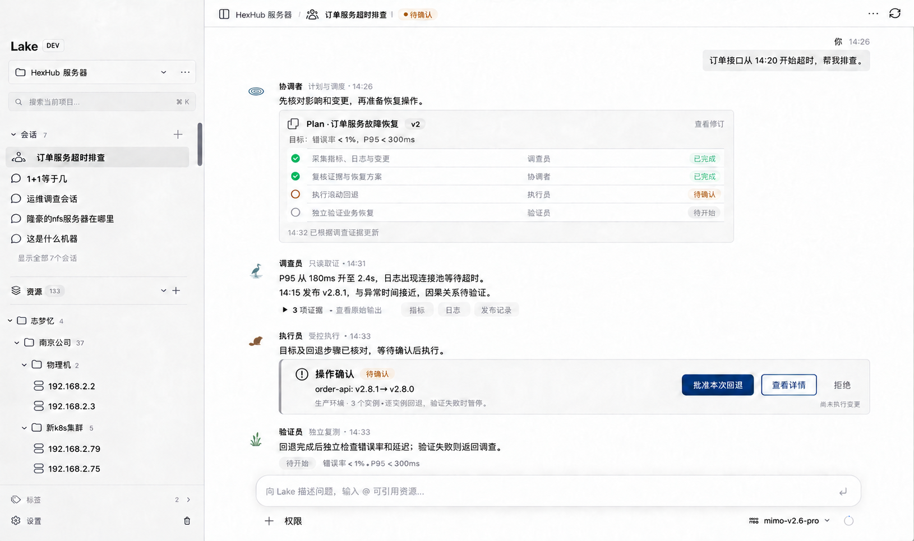
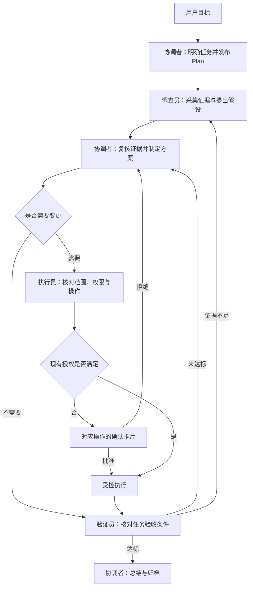
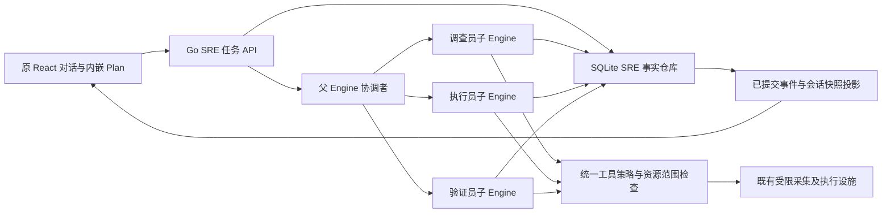

# Introduction


Lake 面向需要调查、处置和验证服务问题的运维工程师与小型 SRE 团队。用户在原有项目和会话中描述目标，四个固定专员在同一对话中协作：协调者维护 Plan，调查员提供证据，执行员落实操作，验证员独立检查效果。整个任务保留目标、依据、权限、实际操作和验证结果。

产品定位：**Lake 是帮助工程师完成故障调查、受控处置、恢复验证和经验沉淀的 AI SRE 工作台。**

本次仅交付产品与技术方案、实施任务和概念图；没有实现下面的新增功能，也没有执行构建、安装、资源操作、提交或发布。概念图使用示例任务表达交互，不代表截图中的调查或回滚实际发生。本文依据 2026-10-15 工作区现状编写，实施前重新核对相关文件；已有大量未提交修改，不能覆盖或归入本功能。



## 1. Requirements & Constraints

- **REQ-001**: 产品固定四个角色 `coordinator`、`investigator`、`executor`、`verifier`；中文名称为协调者、调查员、执行员、验证员。角色数量固定，实例按任务创建，不要求每轮都调用四个角色。
- **REQ-002**: 四个角色的真实进度、交接、发现和结果进入同一用户会话。不得由主模型虚构四段署名回复来代替独立运行记录。
- **REQ-003**: Plan 是持久化的任务对象，在协调者消息内展示，可查看版本、修改、暂停、继续；每一步关联角色、资源、执行尝试、证据和验收条件。
- **REQ-004**: 每个运维任务遵循“明确目标—观察取证—制定方案—执行—验证—归档”的生命周期。简单查询按规则精简；流程深度与实际影响相匹配。
- **REQ-005**: 事实、假设、建议、已执行操作和验证结论分别存储与展示；命令退出码为零不能直接判定业务恢复或根因确认。
- **REQ-006**: 用户可以查询任一新任务的完整执行记录，离开页面和跨多轮对话后继续处理同一任务。一个会话允许多个任务，首版每会话最多一个活动任务。
- **REQ-007**: 执行员与验证员使用独立上下文。验证员读取明确的目标和验收条件，重新采集必要状态；执行员自述不构成验证证据。
- **REQ-008**: 缺少工具、服务映射、指标来源或验证条件时，明确呈现缺口；不能把未接入的 Grafana、发布平台或业务探针显示成已有能力。
- **REQ-009**: 所有角色共享父任务总预算，使用现有模型、用量和上下文机制；预算耗尽时保留进度与证据，不将未完成任务标为成功。
- **REQ-010**: 保持当前 Lake 项目侧栏、资源树、顶栏、会话阅读方式、输入框及权限／模型控件；Plan 和专员回应在对话中呈现。
- **REQ-011**: 角色使用小尺寸、无背景的湖生态图形：水波、白鹭、河狸、芦苇；正文保持明确的职责名称。
- **REQ-012**: 角色交接由结构化产物和服务端事件驱动；模型自然语言、远端输出和角色名称均不能改变权限或任务状态。
- **SEC-001**: 有效权限为父会话当前权限、任务资源范围、角色能力上限、本次操作授权的交集；既有授权有效时沿用，不因角色交接重复索要确认。
- **SEC-002**: 沿用现有静默执行、文件／SQL 权限、禁止本地执行、引用资源限制、SSH 信任及灾难性操作规则。新 Profile 不允许放宽这些规则。
- **SEC-003**: 操作派发前持久化冻结的目标、参数摘要和授权关联；派发结果不明时进入 `unknown`，先核实状态，不自动重放写操作。
- **SEC-004**: 模型密钥、SSH 私钥及其他秘密不进入 Plan、消息、事件、证据摘要、截图和日志。运行使用私有 secrets，不读 Keychain；新增敏感文件沿用 0700 目录、0600 文件权限。
- **CON-001**: 实施基于当前 `internal/ai`、`internal/web`、`web-agent/web` 的 Go/React 架构；不恢复已移除的 ZCode 运行时，不依赖历史 `lake/workflow` 路径。
- **CON-002**: 保留旧 AgentRun、工作流、会话和客户端的兼容读取。新任务采用新契约，历史事实不重命名、不补造角色发言或 Plan。
- **CON-003**: 本地联调仅用独立 Lake Dev；按 `scripts/build_lake_desktop.sh --dev --install` 构建安装。CLI 只能由 `scripts/build_lake.sh` 签名构建，不操作正式版应用及数据。
- **CON-004**: 普通界面图标继续使用 `Glyph`、表单单选继续使用 `AppSelect`、厂商品牌继续使用 `ProviderIcon`。角色专用图形统一从 `AgentIcon` 输出本地 SVG。
- **GUD-001**: 默认显示角色的简明说明、产物、证据和当前动作；工具原始输出按需展开，不把完整模型内部推理作为产品依赖。
- **PAT-001**: 一个父协调 Engine，按需启动受限的角色子 Engine；以统一任务仓库保存事实，以现有工具策略落实执行，以同一对话投影展示协作。

### 1.1 产品范围与成功标准

首个版本聚焦单人、单项目内的故障调查、有限变更及恢复验证。已有 SSH、数据库、Redis、容器等能力按实际资源类型使用。服务名称可以先是任务内的显式映射，不要求先建设完整服务目录或 CMDB。

| 范围 | 首版交付 | 后续方向 |
|---|---|---|
| 故障调查 | 明确影响、证据、假设及未确认事项 | 告警接入、跨服务关联 |
| 操作处置 | 已接入目标上的明确动作，沿用现有授权 | 验证过的有限自动处置 |
| 恢复验证 | 可执行检查、时间窗、阈值、缺失状态 | 长期 SLO、错误预算和持续观察 |
| 经验沉淀 | 任务总结、证据索引、遗留事项、运行手册草稿 | 团队知识、复发分析 |
| 协作 | 同一工程师与四个角色的会话 | 多人值班、交接和团队授权 |
| 部署 | 当前桌面及同源 Web 后端 | 可选常驻执行端 |

首版不建设自有指标／日志存储，不要求打开桌面应用就承担全天候告警值守，不新增完整可视化工作流编辑器。模型调用次数、专员发言数量和生成文字长度不作为价值指标。

验收首先看：关键证据能否追溯；目标与操作是否准确；无效假设能否纠正；执行与验证是否分离；中断和恢复是否可靠；用户能否从对话判断下一步需要谁做什么。效率指标记录首次有效证据耗时、人工补充次数、任务完成耗时、模型用量及错误结论，不在缺乏样本时承诺 MTTR 降幅。

### 1.2 当前实现与差距

下表是本次核对的代码事实，不能用旧方案中标为 Completed 的历史能力替代当前实现核查。

| 已有接入点 | 当前事实 | 本方案新增部分 |
|---|---|---|
| `internal/ai/engine.go`：`Engine.ChatTurn`、`SnapshotPage`、`Abort`、`Decision` | 父会话循环、快照、停止及审批 | 跨轮任务身份、角色上下文与 Plan 生命周期 |
| `internal/ai/multi_agent.go`：`AgentRun`、`runInvestigations`、`agentWorker.run` | 有独立子 Engine；当前工作角色为 host/application/data/verify，显示名 Scout/Trace/Deep/Beacon | 固定产品角色、调查能力与角色解耦、执行员 |
| `internal/ai/multi_agent.go`：`observationTools`、`childObservationTools` | 调查员使用受限采集；当前 verify 主要开放 `read_evidence` | 验证员按范围重新采集结果，保留只读上限 |
| `internal/ai/agent_evidence.go`：`storeAgentEvidence`、`readAgentEvidence` | 证据原文私有保存、摘要及分页 | 跨轮任务证据索引、验证来源隔离及读取权限重验 |
| `internal/ai/tools.go`：`Engine.policy`、`Engine.invoke` | 已有工具政策与执行路径 | 叠加角色约束、Plan 绑定、操作派发前登记 |
| `internal/ai/workflow.go`：`ChatWorkflow`、`validateWorkflow`、`executeWorkflow` | 保存显式只读调查步骤并串行运行，末尾复核 | 不直接变成任意写操作 Plan；通过显式适配导入 |
| `internal/ai/types.go`：`View`、`State` | 已有 todos、cards、agentRuns、rootTurnId | todos 保持轻量；新增独立 SRE 任务对象及展示契约 |
| `internal/web/store.go`、`schema.sql` | SQLite、会话事件和快照；事件类型存在 CHECK | 新增任务事实表；复用 `session` 通知，不直接塞新外层事件类型 |
| `internal/web/agent.go`：`Server.event` | 当前 done 事件把本轮结束映射为会话 completed/failed | 分离本轮回复结束与运维任务完成，保留未验证状态 |
| `web-agent/web/src/AIPanel.tsx`：`AITranscript`，`AgentTaskList.tsx` | 当前偏向折叠子任务／工具记录 | 新任务按角色署名直接回应；旧任务继续原展示 |
| `web-agent/web/src/agentTasks.ts`、`AgentIcon.tsx` | 当前按领域角色映射名称和功能图标 | 新任务四角色映射及湖生态头像，历史映射保留 |

旧 `plan/architecture-lake-multi-agent-1.md` 提出的八种领域模板在本方案中收敛为内部能力模块；本方案的新任务不以八种模板作为用户角色名单。旧“仅主 Agent 与用户对话”的规则不适用于新协作任务。`docs/lake-design.md` 已标注为停用 ZCode 架构的历史记录，不作为本方案实施依据。

### 1.3 四个固定角色

| 角色 ID／名称 | 职责与输入 | 结构化交付 | 能力边界 |
|---|---|---|---|
| `coordinator`／协调者 | 理解目标，解析范围、完成标准和用户修订；接收各角色产物，更新 Plan | 任务定义、计划版本、交接请求、综合结论和遗留事项 | SRE 任务内只使用编排、目录和证据读取能力；不能绕过执行员直接写资源、授予权限或改写验证结果 |
| `investigator`／调查员 | 按问题采集主机、日志、数据库、网络、集群及变更信息 | 事实及证据 ID、假设、反证、缺口、下一项检查 | 默认只读；没有任意 Shell／SQL／文件写入和递归委派 |
| `executor`／执行员 | 接收已具体化的操作方案，核对目标、前置条件与已有授权，提交操作 | 冻结的操作、实际结果、操作后状态及回退建议 | 只能执行任务绑定动作；调用现有策略；不自己判断业务已恢复 |
| `verifier`／验证员 | 接收目标、前态、执行事实和验收标准，独立采集后态 | 每项检查的 pass/fail/inconclusive、证据、总体结论 | 默认只读；不改配置、不重复执行处置；不能用旧证据冒充后态 |

协调者复用父 Engine，不再额外启动一个“总 Agent”。其余角色使用独立子上下文。调查员可以按主机、日志、数据等能力创建多个实例，但界面保持“调查员 · 应用日志”等职责标识；每个实例有独立 runId，不能把三个独立实例伪装成一个连续上下文。

新运行记录增加 `sreRole` 与 `capabilityIds`，保留原 `AgentRun.role` 的兼容含义；所有新 SRE 调度校验都依据服务端角色策略，不以 UI 映射作为权限控制。旧记录继续展示旧身份。

固定角色不表示强制四人发言。查询型任务可以由协调者与调查员完成；没有变更就无需执行员；验收条件准备是服务端状态，默认不让验证员专门发送“我在等待”的占位消息。概念图为展示角色而呈现完整队列，实际界面只显示真实、有新增信息的发言。

### 1.4 对话中的交互

默认入口保持现有输入框。用户提出多步骤运维任务后，协调者在原会话建立任务并发布内嵌 Plan。用户明确说“只出计划”时，保存 Plan 并停在草稿；必要背景调查仍按当前只读权限进行，资源检查本身不伪称无副作用。

典型对话：

1. 用户：订单接口从 14:20 开始超时，帮我排查。
2. 协调者：确认生产环境、目标服务与时间范围；建立调查 Plan，未知条件作为待补充项。
3. 调查员：报告延迟、连接池等待与发布记录；引用来源，明确时间接近尚不能证明因果。
4. 协调者：汇总依据，形成恢复动作并更新 Plan；未取得具体动作前不预设回滚。
5. 执行员：提交目标、步骤、影响、停止条件和验证方法；现有授权不足时在该消息下展示确认卡片。
6. 执行员：执行后报告实际结果；部分实例失败分别记录，不把一条命令成功汇总成全体成功。
7. 验证员：按验收标准重新采集状态，给出恢复、未恢复或无法确认。
8. 协调者：保存结论、恢复与根因状态、已尝试动作和遗留事项；需要继续调查时保留活动任务。

用户回复“先只检查，不要回滚”时，停止待派发的变更步骤，更新 Plan；已派发操作不能被描述为从未发生。“继续”默认指当前活动任务；存在待确认操作时仍通过该操作对应的既有确认机制处理，模糊文本不扩展操作授权。用户切换到不兼容目标时，保留旧任务并明确创建新任务或暂停旧任务，不能静默替换范围。

人工接管终端时，在可识别归属的任务中记录“人工操作”及命令块来源，Agent 释放同一终端输入权。用户在其他终端／工具做的变更可以显式补录为外部变更；没有实际命令记录时标明用户提供，不能伪造工具证据。继续自动处理前重新采集受影响状态。固定角色约束覆盖本任务的 Agent 操作，不把人工输入追认成某个专员已经执行。

角色头像和名称属于可信服务端元数据；正文里的 `@协调者` 或伪造角色名称不产生系统身份。后续 `@专员` 用于路由问题或请求检查，不代表启动全部角色、不改变授权。首版保持现有 @资源／Skills／MCP 行为，专员定向引用在第二阶段加入明确的 `role` 引用类型。

### 1.5 Plan 的定义、版本与执行

Plan 与普通 todos、保存的工作流、运行记录分别管理：todos 组织当前回复，Plan 组织一次运维任务，工作流保存复用定义，执行记录保存实际事实。完整任务可以跨多个 rootTurnId；每次尝试有新的 runId，不能复用旧运行的“成功”状态。

| 对象 | 必填核心字段 | 规则 |
|---|---|---|
| `SRETask` | id、sessionId、goal、scope、status、outcome、profileId、profileVersion、createdAt、updatedAt | 服务端生成身份；scope 使用明确资源 ID，服务名不直接等于可执行目标 |
| `SREPlanRevision` | id、taskId、version、goal、scope、steps、acceptance、changeReason、createdAt | 每次修订追加不可变版本；version 从 1 递增；引用来源与不确定性一并保存 |
| `SREPlanStep` | id、role、kind、description、dependsOn、resourceIds、completionChecks | kind 为 observe/analyze/act/verify/summarize；act 还必须具备具体动作与停止／回退说明 |
| `SREPlanRun` | id、taskId、planRevisionId、profileVersion、status、startedAt、finishedAt | 绑定不可变计划快照；恢复同一 run 不自动重发操作，重新执行创建新 run |
| `SREStepAttempt` | id、planRunId、stepId、roleRunId、status、operationIds、evidenceIds、result | 同一步重试创建新 attempt；状态与新旧证据不覆盖 |
| `SRETranscriptEntry` | id、sessionId、taskId、roleId、roleRunId、kind、body、revision、createdAt、sequence | kind 为 plan/finding/handoff/action/result/verification/summary/error；客户端不得指定真实发言身份 |
| `SREVerificationResult` | taskId、planRunId、checks、verdict、evidenceIds、checkedAt | verdict 为 passed/failed/inconclusive；由服务端检查聚合规则与证据时间 |

计划约束：每版最多 32 步，依赖必须为无环图；每步最多 8 个项目内资源，模型输入缺少范围时先解析或询问。服务端拒绝未知字段中的授权标志、凭据、可执行 JavaScript 和任意条件表达式。

`completionChecks` 使用登记的检查类型、来源、比较符、阈值、单位、观察窗和最少样本数；首版支持 number_threshold、boolean_probe、manual_attestation。没有数据源时为 inconclusive，不静默切成主观成功。人工确认单独显示“人工确认”，不等同于自动探测通过。示意图中的错误率 1% 和 P95 300ms 只是示例，不作为所有服务默认目标。

首版计划执行快照保持不可变：

- 尚未执行的草稿可修订并选择最新版本启动。
- 运行中“修改 Plan”先申请暂停，在没有在途操作且结果都已核实的安全边界创建后继版本和后继 run；旧 run 标记 superseded，已发生事实留在旧 run。
- 新版只可引用旧证据作为背景，不能默认把旧版步骤勾为已完成；若要复用结果，服务端确认相同目标、检查定义、时效及未被变更影响，并保存显式 `reusedFromAttemptId`。
- 已派发写操作或 unknown 结果存在时，禁止把该操作换成新参数继续运行；先核查并记录处置。
- 确认卡片绑定 taskId、planRunId、stepAttemptId、操作摘要、资源身份与权限版本；新版不能复用旧参数的确认。

界面中 Plan 主卡片保持原消息锚点并显示当前版本和“已更新”时间；修订作为新事件保存，“查看修订”可对比，不把新的卡片更新时间当成最初已经确定方案。

### 1.6 生命周期与分支



紧急任务可以把“先止损”作为显式目标生成方案；不强求查明根因后才能恢复。完成记录始终分开 `recoveryStatus` 和 `rootCauseStatus`：恢复可以 verified/unverified/not_applicable，根因可以 confirmed/suspected/unknown/not_applicable。

| 状态对象 | 状态集合与转移 |
|---|---|
| 任务 status | draft → active；active 可到 waiting_input、waiting_approval、paused、completed、failed、cancelled；等待／暂停返回 active 前重验范围；终态不能被迟到事件恢复 |
| 运行 status | queued → running；running 可到 waiting_input、waiting_approval、pausing、completed、failed、unknown；等待状态经重验可回 running；pausing → paused；queued、等待和 paused 可取消；paused 可恢复 running 或终止 superseded；启动恢复时未完成的 queued/running/pausing 标记 interrupted，waiting_approval 标记 paused 并使旧确认失效 |
| 步骤 status | pending → running → succeeded/failed/unknown；pending 可到 skipped/cancelled；等待输入或权限附属于活动 attempt；unknown 不等于 failed，不自动重试 |
| 验证 verdict | passed、failed、inconclusive；无数据、缺少样本、数据过期或工具缺失一律 inconclusive |

任务 completed 由服务端根据该任务类型的必需步骤及验收结果决定；failed/cancelled 也可以归档，但必须显示失败／取消而非成功。调查任务可以以“结论不确定、调查已结束”完成，outcome 为 inconclusive；恢复任务若验证 inconclusive，则维持待补充或暂停，不能显示“已恢复”。原 WorkSession.status 为兼容投影，不能把一轮回复结束等价为 SRETask.completed。

unknown 和 interrupted 运行保留原身份及终态，不直接改回 running。继续时先创建只读核查尝试；结果明确后创建带 `resumeOfRunId` 的新运行，引用已确认事实。旧操作维持原记录，核查结论作为关联事件追加；任务在核查期间显示 paused／waiting_input。停止请求在尚未派发时可取消，派发后是否已产生影响仍按实际执行事实判断。

简单查询不强制完整 Plan 卡片：仍记录目标、范围、实际查询、证据和结论，标记 taskType=query。多资源、多阶段、变更或跨轮任务展示 Plan；用户可主动要求显示／隐藏卡片，但无法隐藏尚待处理的审批和结果不明状态。

### 1.7 Lake SRE Harness Profile

本方案把 Profile 定义为 **Lake 自有的角色与运行策略配置**，并非声称遵循某个外部 HarnessProfile 标准，也不要求引入新的 Agent 框架。模型适配配置与业务角色策略分别保存。

首版提供内置、不可由模型修改的 `lake.sre.assisted` v1：

| 配置项 | 固定策略 |
|---|---|
| 角色注册 | 仅 coordinator/investigator/executor/verifier；模型不能动态创建第五种产品角色 |
| 调查能力 | 依据资源 kind 和实际工具目录选择 host/logs/data/network/cluster/change 能力；未实现的能力不可列为可调用 |
| 执行能力 | 新执行员仅对冻结动作进入现有工具策略；不把全部父工具目录交给子 Engine |
| 验证能力 | 同范围受限读取与登记探针；按能力显式授权，不开放任意 Shell 或 SQL |
| 调度 | 同任务最多 2 个调查实例并行；同目标写操作串行；不同角色不共用交互终端输入权 |
| 深度 | 委派深度 1；子角色不能继续委派，所有交接回协调者 |
| 模型 | 默认继承会话当前供应商和模型；有待执行任务时切换模型不更改已派发实例和操作绑定 |
| 用量 | 复用 `agentUsageLimits`、现有请求期限、工具上限与任务上限；协调者、调查、执行及验证计入同一任务账本；本方案不自动提高既有额度 |
| 等待 | 等待真实事件，前端更新不触发额外模型请求；每个角色完成后只输出有新增内容的交付 |
| 完成门槛 | 目标范围明确；动作可追溯；恢复任务具备有效验证；不能由正文直接置成功 |

任务创建时冻结 `taskTokenBudget`，上限取创建时 `agentUsageLimits` 返回的父轮累计额度；新建 Plan 版本、跨轮继续和切换模型都不重置该任务账本。协调者与各子角色在请求前预留、返回后结算，缺失用量沿用保守估算并标注。原单轮、单子任务及并发限制继续同时生效，取更严格的额度；额度用尽时等待用户显式调整预算或结束任务，不自动提高。角色发言、格式修正与总结都计入该任务，不能因父子上下文分别保存而漏计协调者。

每次任务冻结 profileId/version，执行中修改设置只影响之后新建任务。允许后续增加巡检、发布等配置，但保留同一组角色；不在首版提供任意脚本式 Profile 编辑器。

角色结构化报告统一包含 summary、observations、hypotheses、unknowns、evidenceIds、nextSteps；执行报告另有 operationIds 和 dispatchOutcome；验证报告另有 checkResults 和 verdict。服务端验证 schema、证据归属及真实运行状态后才发布对话条目。格式错误只允许一次无工具的格式修正，仍计入预算；再次失败保留证据并标为结果无效。

### 1.8 UI 与湖生态视觉

采用本方案开头的最终概念图：保留当前界面，只在会话中增加署名回应与内嵌对象。默认不增加右侧角色仪表盘，不增加单独 Plan 首页，不增加顶部四角色占位工具条。

| 元素 | 设计规格 |
|---|---|
| 专员消息 | 小图形、职责名称、简短当前工作和时间；下面是自然语言结论及必要的卡片 |
| Plan 卡片 | 协调者消息内；名称、版本、目标、步骤、负责人、状态；支持折叠、修订、暂停／继续 |
| 证据 | 调查员／验证员消息下显示数量、来源、采集时间；展开后分页读取原文 |
| 操作确认 | 执行员消息内，复用现有确认组件和深蓝按钮；清楚显示目标、实际动作、影响与验证 |
| 执行记录 | 沿用现有入口；按任务筛选，查看角色、交接、Plan 版本、工具及操作结果，支持回到对应消息 |
| 输入区 | 保留现有布局与 @资源、附件、权限、模型选择；专员定向引用后续扩展，不替换现有控件 |
| 活动状态 | 出现在真实运行角色附近；未启动角色不模拟输入中，不循环展示空泛等待消息 |

头像统一使用本地、代码可维护的 SVG，视觉边界最大 22×22 CSS px，布局槽为 28×28px；无底色、无外框、无圆盘、无阴影、无表情及卡通身体。由于形状不同，以视觉重量而非强行拉伸保持大小一致；手机宽度下图形最大 18px。角色识别始终有文字，不只依赖颜色。

| 角色 | 湖生态形象 | 浅色前景 | 深色前景 | 设计意图 |
|---|---|---|---|---|
| 协调者 | 水波 | `#52758B` | `#9DB9CB` | 联系与调度 |
| 调查员 | 白鹭剪影 | `#557F78` | `#9BC2B8` | 观察与发现 |
| 执行员 | 河狸剪影 | `#9B7957` | `#CDB18D` | 建设与行动 |
| 验证员 | 芦苇剪影 | `#70856B` | `#AFC3A7` | 稳定与守望 |

颜色写入 `theme.css` 的语义变量 `--agent-coordinator`、`--agent-investigator`、`--agent-executor`、`--agent-verifier`；SVG 使用 currentColor。头像只承载品牌和身份，成功／等待／失败另用已有状态标志，不能把河狸变红表示执行失败。动画仅复用现有状态组件并尊重 reduced-motion，不让动物跳动。

### 1.9 技术架构与事实来源



新增 `internal/ai/sre_repository.go` 的 `SRERepository` 接口，在 `internal/web/sre_store.go` 以 SQLite 实现；`internal/ai` 不反向导入 `internal/web`。Server 初始化时通过新增 `Engine.SetSRERepository` 注入。首版只在桌面／Web 的 core 会话开放；没有仓库适配的 CLI 保持原行为，不静默使用第二套 SRE 文件数据库。

SQLite 是新增任务、Plan、执行尝试和可见角色消息的唯一事实来源；既有私有 Engine JSON 继续保存模型上下文及兼容 AgentRun，但不作为第二个可覆盖任务状态的安全事实源。新增表为 `sreTasks`、`srePlanRevisions`、`srePlanRuns`、`sreStepAttempts`、`sreMessages`、`sreEvents`、`sreVerificationResults`；外键绑定父会话／任务，删除沿用已有可恢复删除语义与活动任务停止规则。

核心仓库操作为 CreateSRETask、AppendSREPlanRevision、StartSREPlanRun、AppendSREEvent、ListSRETasks、SRETaskSnapshot。每次状态和对应事件在同一事务提交；以 clientRequestId 做幂等约束，以 revision 做乐观锁。任务 ID、角色 ID、时间、序号、runId 和权限指纹由服务端写入；HTTP／模型不能自行指定可信身份。

`sreEvents` 使用全局递增 sequence，在会话范围内查询；事件携带 taskId、planRunId、stepAttemptId、roleRunId、type、payload。页面按事件序号排序并以事件 ID 去重，不依赖模型生成时间或不同请求的到达顺序。通知在提交后通过已有 session 事件发出；事件表同时作为待发布通知来源，重连补快照并按游标补齐，避免提交后进程退出导致永远漏通知。

新增 `SRETaskService` 单向调用协调器与仓库；新增 `Engine.StartSRETask`、`ResumeSRETask`、`RunSRERole` 作为调度入口，实际模型推理复用 ChatTurn／子 Engine 设施，工具调用继续经过 policy/invoke。恢复时核对 SQL 中的操作状态和私有上下文，不一致时暂停核查，不猜测成功、不重放。

证据原文继续由 `storeAgentEvidence` 私有保存；SQL 只登记索引、摘要及来源。新增任务级证据读取接口，不直接扩大现有 `readAgentEvidence` 的当前轮次过滤。验证员可读取本任务明确纳入范围的前态，并产生新的后态证据；保留来源角色及采集时间，不能把自己新采集的后态因当前 verify 过滤规则遗漏。

### 1.10 API 与兼容

以下均为待新增接口，复用当前认证、同源限制与父会话归属检查。

| 方法／路径 | 行为 |
|---|---|
| `POST /api/sessions/:sid/sre/tasks` | 创建任务；正文 goal、resourceIds、mode、clientRequestId；mode 为 assist 或 plan_only |
| `GET /api/sessions/:sid/sre/tasks` | 分页列任务；limit 默认 20、最大 50，cursor 为服务端游标 |
| `GET /api/sessions/:sid/sre/tasks/:tid` | 返回任务、当前 Plan、运行及消息摘要，不返回模型秘密或完整原文 |
| `POST /api/sessions/:sid/sre/tasks/:tid/plans` | 根据 expectedVersion 追加计划版本；版本冲突返回 409 |
| `POST /api/sessions/:sid/sre/tasks/:tid/start` | 以明确 planVersion 启动；防重复点击，不以开始计划代替各操作所需授权 |
| `POST /api/sessions/:sid/sre/tasks/:tid/control` | pause/resume/cancel；带 expectedRevision 与 clientRequestId，重复控制不产生重复动作 |
| `GET /api/sessions/:sid/sre/tasks/:tid/events` | after、limit，limit 最大 100；返回真实事件及 nextCursor |
| `GET /api/sessions/:sid/sre/tasks/:tid/evidence/:eid` | 重验会话、任务和资源归属；原文分页每页最大 4096 字节，返回截断信息 |

`SessionSnapshot.sre` 为可选字段，包含 featureVersion、活动任务摘要及当前页展示条目；历史按任务和消息游标加载。新 RoleMessage 进入普通会话的展示投影，不伪装成用户 Message，不把同一专员报告同时重复追加到父模型历史与 UI 两次。

确认操作继续调用原 Decision／AgentDecision 路径，由现有确认 ID 查找绑定的 SRE attempt；审批不能通过新 Plan API 绕过。`AgentRole` 保留旧联合类型，另增 `SREAgentRole`；外层 SSE 不新增不兼容 type。旧客户端忽略新增字段，旧记录沿原 UI 展示；不对历史会话推测 Plan 和角色发言。

### 1.11 失败、停止与验证要求

| 场景 | 固定处理 |
|---|---|
| 资源身份不明确 | 进入 waiting_input；展示候选目标，未明确前不派发 |
| 工具能力缺失 | 记录 missing_capability；保留已取得证据，不编造成功 |
| 证据不支持原假设 | 标记假设 refuted 或 unverified，协调者调整调查路径 |
| 同一检查数据过期 | 重新采集；旧证据保留并注明过期，不直接继承通过 |
| 审批拒绝／权限变更 | 停止待派发步骤，回到方案或暂停；不自动换命令绕过 |
| 执行断线／超时 | 标记 unknown，核实后才能继续；不能靠重复调用查询写结果 |
| 多实例部分失败 | 分实例记录；按停止条件暂停后续实例；回退自身也是新受控动作 |
| 验证数据不足 | verdict=inconclusive；明确无法确认的标准和需要补充的来源 |
| 验证失败 | 返回调查／方案；达到预算或连续两次验证失败时暂停，保留现场供用户继续 |
| 停止本轮 | 停止推理与待派发动作；已运行命令沿用现有观察语义，不自动等同中断命令 |
| 中断命令／关闭终端 | 沿用现有操作语义；无明确退出结果时保留 unknown |
| 刷新／浏览器断连 | 后端任务继续；重连恢复快照，不重启动作 |
| 服务重启 | 原运行转 interrupted／paused；核对执行事实，用户继续时重新检查目标、授权与证据时效 |

验证检查必须声明采集来源和时间窗。执行后结果的采集时间必须晚于该操作完成时间；变更前的证据只作为基线。服务仍在启动、样本不足、接口只测到本机健康而未覆盖业务路径时，结果应明确限度。可选手动验证需有用户身份和时间，不能由 Agent 代填。

## 2. Implementation Steps

2026-10-16：核心纵向流程已实现并安装签名版 Lake Dev。下表保留原始实施目标；实际实现和验证范围以 [验收记录](../docs/validation/lake-sre-collaboration.md) 为准。尚未完成的完整故障演练和原生窗口验收明确保留为 Partial。各阶段声明依赖，阶段内任务按所列依赖执行，未列依赖的任务可以由同一实施者独立推进。任务表不会自动授权启动并行 Agent。

### Implementation Phase 1

- **GOAL-001**: 冻结任务契约、状态机、持久化与兼容边界；可在隔离环境创建和恢复不执行资源操作的任务。

| Task | Description | Completed | Date |
|------|-------------|-----------|------|
| TASK-001 | 新增 `internal/ai/sre_types.go` 与 `sre_state.go`，定义 1.5–1.6 的类型和 ValidateSREPlan、TransitionSRETask、CanCompleteSRETask；在 `web-agent/shared/contracts.ts` 增加同名可序列化类型及可选 SessionSnapshot.sre。 | Yes | 2026-10-16 |
| TASK-002 | 依赖 TASK-001。新增 `internal/ai/sre_repository.go`、`internal/web/sre_store.go`；扩展 `schema.sql` 与 `Store.migrate` 建立 1.9 所列事实表、外键、版本及幂等索引，实现该节列出的仓库操作，迁移保留旧数据。 | Yes | 2026-10-16 |
| TASK-003 | 依赖 TASK-002。新增 `internal/web/sre_routes.go` 的 `Server.sreRoute`，在 `ServeHTTP` 接入 1.10 的任务／版本／控制／事件路由；实现 401/403/404/409 和输入上限，不派发真实工具。 | Yes | 2026-10-16 |
| TASK-004 | 依赖 TASK-001、TASK-002、TASK-003。新增 `sre_state_test.go` 与 `internal/web/sre_store_test.go`，覆盖状态合法性、循环依赖、版本冲突、跨会话访问、迁移与重复请求；建立带假运行器的纵向任务样本。 | Yes | 2026-10-16 |

阶段完成标准：同任务跨两轮恢复、两次重复启动只产生一个 run、旧快照仍可读取、状态与事件同事务保存；全部由假执行器验证，无真实写操作。

### Implementation Phase 2

- **GOAL-002**: 依赖 Phase 1。交付真实的只读角色协作、对话内 Plan 和专员署名回应，保持现有 UI。

| Task | Description | Completed | Date |
|------|-------------|-----------|------|
| TASK-005 | 依赖 TASK-004。新增 `internal/ai/sre_profile.go`、`sre_orchestrator.go`、`sre_roles.go` 与四份 `prompts/sre-*.txt`；实现 SetSRERepository、StartSRETask、ResumeSRETask、RunSRERole；协调者复用父 Engine，调查员通过现有受限采集与独立子 Engine 工作，未开放 executor 写能力。 | Yes | 2026-10-16 |
| TASK-006 | 依赖 TASK-005。在 `multi_agent.go` 的 AgentRun、scopedChildConfig、childObservationTools 与 `agent_budget.go` 叠加 sreRole、任务范围和共享预算；新增 `sre_evidence.go` 的任务证据索引／重验逻辑，不取消旧当前轮次过滤。 | Yes | 2026-10-16 |
| TASK-007 | 依赖 TASK-005。新增 `internal/web/sre_service.go`，在 `internal/web/server.go` 的包级 `New` 函数注入仓库；在 `Server.event` 分开处理回复结束和活动 SRE 任务，按已提交事件发布会话通知并实现重连补齐。 | Yes | 2026-10-16 |
| TASK-008 | 依赖 TASK-001。新增 `web-agent/web/src/SREPlanCard.tsx`、`SRERoleMessage.tsx`、`sreTranscript.ts`、`sreCollaboration.css`；在 `AIPanel.tsx` 的 AITranscript 按稳定 sequence 投影新条目，旧 AgentTaskList 保留；在 `api.ts` 接入新接口。 | Yes | 2026-10-16 |
| TASK-009 | 依赖 TASK-008。扩展 `AgentIcon.tsx`、`agentTasks.ts`、`theme.css`，实现四个最大 22px、无底色的湖生态图形与明暗语义颜色；普通 Glyph／ProviderIcon 保持原行为。 | Yes | 2026-10-16 |
| TASK-010 | 依赖 TASK-006、TASK-007、TASK-008、TASK-009。完成只读调查及 plan_only 纵向验收：真实子运行产生署名消息，证据可展开；保存计划不执行变更，刷新不重建任务。 | Yes | 2026-10-16 |

阶段完成标准：用户在同一对话看到协调者 Plan 和真实调查员发现；原始证据与运行 ID 可核对；不会为未启动角色生成占位发言；移动端与深色主题可阅读。

### Implementation Phase 3

- **GOAL-003**: 依赖 Phase 2。交付执行员、独立后态验证与结果不明保护，在隔离环境完成恢复闭环。

| Task | Description | Completed | Date |
|------|-------------|-----------|------|
| TASK-011 | 依赖 TASK-010。新增 `internal/ai/sre_execution.go` 的 PrepareSREOperation、DispatchSREOperation；在 `tools.go` 的 policy/invoke 与 `internal/web/agent.go` 的 bridge 关联冻结操作及 attempt。复用原审批／资源／终端检查，实施按目标串行和派发前登记。 | Yes | 2026-10-16 |
| TASK-012 | 依赖 TASK-006。新增 `internal/ai/sre_verification.go` 的 BuildVerificationChecks、EvaluateVerification；为 verifier 开放按范围选择的只读采样，不开放任意命令；记录新后态证据，缺少探针时返回 inconclusive。 | Yes | 2026-10-16 |
| TASK-013 | 依赖 TASK-011、TASK-012。在 `sre_orchestrator.go` 实现方案—执行—验证交接和失败返回；明确 task outcome、recoveryStatus、rootCauseStatus；在安全边界按 1.5 创建后继版本／运行。 | Partial | 2026-10-16 |
| TASK-014 | 依赖 TASK-011。在 `SREPlanCard.tsx`、`SRERoleMessage.tsx` 复用 `AIPanel.tsx` 的 AIPending 确认入口；展示拒绝、暂停、unknown、部分失败；不因卡片更新改变消息锚点。 | Yes | 2026-10-16 |
| TASK-015 | 依赖 TASK-013、TASK-014。新增 `sre_execution_test.go`、`sre_verification_test.go` 与 Web 集成测试；覆盖批准／拒绝、静默权限、参数更改、进程崩溃窗口、重复派发、验证失败和旧证据拒用。 | Partial | 2026-10-16 |

阶段完成标准：完成一次可复现的测试服务故障、受控恢复和独立验证；拒绝审批零派发；unknown 写操作零自动重放；无业务指标时只能声称实际已验证的健康范围。

### Implementation Phase 4

- **GOAL-004**: 依赖 Phase 3。交付跨轮交接、完整历史、专员定向沟通与灰度开关。

| Task | Description | Completed | Date |
|------|-------------|-----------|------|
| TASK-016 | 依赖 TASK-015。在 `sreTranscript.ts` 与现有 activity 展示中加入任务筛选、事件定位、修订对比和历史分页；在 `internal/web/sre_routes.go` 补齐任务证据接口，历史访问重验归属与当前权限。 | Yes | 2026-10-16 |
| TASK-017 | 依赖 TASK-016。扩展 `ComposerMentions.tsx`、`composerMentionState.ts`、`shared/references.ts` 和服务端引用解析；新增 role 引用及专员问题路由，保存队列时保持引用类型；角色引用不能创建授权。 | Yes | 2026-10-16 |
| TASK-018 | 依赖 TASK-016。在 `sre_service.go` 增加显式运行手册草稿导出与旧只读 WorkflowTemplate 到 Plan 的转换；旧定义和旧运行不变。项目记忆只接收可修订摘要，不自动把猜测或失败动作变成经验规则。 | Yes | 2026-10-16 |
| TASK-019 | 依赖 TASK-017、TASK-018。新增 `sreCollaborationEnabled` 项目功能开关，初始为 false；隔离验收后对新项目启用默认值，既有项目显式开启。关闭时停止新建任务并保留历史和活动任务控制，不丢弃 pending/unknown 操作。更新 README、web-agent/README 和用户说明。 | Yes | 2026-10-16 |
| TASK-020 | 依赖 TASK-019。运行 6 节相关检查；按签名脚本构建 Lake Dev，在独立 home 验证完整会话、刷新、重启、明暗主题及 390/1024/1440px 布局；保存脱敏记录到 `docs/validation/lake-sre-collaboration.md`。 | Partial | 2026-10-16 |

阶段完成标准：历史可查、任务可继续、@专员不越权、旧记录无伪造身份；Dev 端完成纵向验收后才讨论上线及默认启用范围。正式版安装和发布另行安排。

## 3. Alternatives

- **ALT-001**: 每次调用强制四个角色依次回复。会增加等待与无信息消息；采用固定角色池，按任务选择实例和分支。
- **ALT-002**: 继续以主机、数据库、日志等领域作为用户可见固定角色。随着能力增加名单膨胀；这些领域改为调查员可用能力，旧记录保持原身份。
- **ALT-003**: 一个模型输出四个署名段落。无法证明真实职责和权限隔离；采用真实角色运行元数据及结构化交付。
- **ALT-004**: 所有任务执行同一张静态脚本流程。无法处理证据不足、先止损和验证失败；采用固定生命周期与受约束 Plan 分支。
- **ALT-005**: 将 Plan 直接保存成 todos 或现有 WorkflowTemplate。缺少版本、跨轮任务和写操作绑定；Plan 新建契约，旧工作流只做显式适配。
- **ALT-006**: 重新设计全套仪表盘或右侧四角色看板。与已确认的对话协作和当前 UI 不符；采用署名消息与内嵌卡片。
- **ALT-007**: 仅用提示词规定审批、验证和角色工具。不能保证执行一致性；由服务端工具策略、仓库和状态机落实。

## 4. Dependencies

- **DEP-001**: 当前 Go Engine、子 Engine、受限 observation 工具、预算限制、私有证据文件与现有审批／终端策略。
- **DEP-002**: 当前 SQLite 迁移、会话认证、事件传输和前端快照恢复；SRE 仓库接口注入不能形成 Go 包循环。
- **DEP-003**: React AITranscript、现有 AIPending、AgentIcon、主题变量、AppSelect 和 ProviderIcon；不引入新的 UI 框架。
- **DEP-004**: 独立测试服务、假模型／故障注入环境与测试数据源；业务恢复验收依赖明确可访问的探针和指标，缺失时不能以截图替代。
- **DEP-005**: 现有签名身份和 Lake Dev 构建流程；本方案不依赖正式版凭据或访问生产目标。

## 5. Files

- **FILE-001**: 本方案 `plan/feature-sre-collaboration-1.md` 与概念图 `docs/design/lake-sre-collaboration-v1.png`，本次新增交付。
- **FILE-002**: 新增 `internal/ai/sre_types.go`、`sre_state.go`、`sre_repository.go`，定义任务模型、状态及仓库端口。
- **FILE-003**: 新增 `internal/ai/sre_profile.go`、`sre_roles.go`、`sre_orchestrator.go`、`prompts/sre-coordinator.txt`、`prompts/sre-investigator.txt`、`prompts/sre-executor.txt`、`prompts/sre-verifier.txt`。
- **FILE-004**: 新增 `internal/ai/sre_evidence.go`、`sre_execution.go`、`sre_verification.go`，扩展 `multi_agent.go`、`agent_evidence.go`、`agent_budget.go`、`types.go`、`tools.go`、`engine.go`、`catalog.go`。
- **FILE-005**: 新增 `internal/web/sre_store.go`、`sre_routes.go`、`sre_service.go`；扩展 `store.go`、`schema.sql`、`server.go`、`agent.go`，按需适配 `workflows.go`。
- **FILE-006**: 扩展 `web-agent/shared/contracts.ts`、`references.ts` 与 `web-agent/web/src/api.ts`；新增 `SREPlanCard.tsx`、`SRERoleMessage.tsx`、`sreTranscript.ts`、`sreCollaboration.css`。
- **FILE-007**: 扩展 `web-agent/web/src/AIPanel.tsx`、`AgentIcon.tsx`、`agentTasks.ts`、`theme.css`、`ComposerMentions.tsx`、`composerMentionState.ts`；普通导航和模型控件保持当前结构。
- **FILE-008**: 新增 `internal/ai/sre_state_test.go`、`sre_execution_test.go`、`sre_verification_test.go`，`internal/web/sre_store_test.go`、`sre_routes_test.go`、`sre_integration_test.go`，`web-agent/web/test/sre-transcript.test.ts`、`sre-plan.test.ts`。
- **FILE-009**: 后续更新 `README.md`、`web-agent/README.md` 与 `docs/validation/lake-sre-collaboration.md`。不覆写历史方案；通过链接注明新任务方向。

## 6. Testing

- **TEST-001**: 对任务、运行和步骤状态机做表驱动测试；拒绝循环依赖、非法状态恢复、跨任务 evidenceId 和模型伪造身份；区分执行成功、任务结束与恢复通过。
- **TEST-002**: 两个会话同时访问同一 task/run/evidence 时验证归属；撤销资源权限后，已有上下文和旧审批不能继续派发或读取受限证据。
- **TEST-003**: 重复 start/decision/control、乱序事件、断线重连和旧版本提交不能产生双重操作或重复可见消息；版本冲突明确返回 409。
- **TEST-004**: 在写派发前、派发后未收到结果、状态落库后未发通知三处注入崩溃；恢复后不重放可能已执行的写操作，已提交事件可恢复。
- **TEST-005**: 真实子角色产物才进入署名对话；主模型生成的“调查员说”不变成可信角色消息；旧角色记录保持旧名称和原证据。
- **TEST-006**: 验证员独立上下文只能使用获准数据和重新采集的后态；命令 exit=0、旧成功证据、样本不足、缺失业务探针均不能单独判定恢复。
- **TEST-007**: 现有静默执行／文件／SQL／引用限制／SSH 信任／禁止本地执行继续生效；有效授权不重复询问，角色不能扩大权限。
- **TEST-008**: Plan 修订、拒绝、暂停、unknown、部分实例失败、预算耗尽、跨轮继续和人工验证分别保留真实结果；旧确认不能绑定新动作。
- **TEST-009**: `sreTranscript.ts` 测试稳定排序、去重、版本更新与消息锚点；`SREPlanCard` 测试真实状态投影，不以标题或自然语言推测成功。
- **TEST-010**: 在 390、1024、1440px 下检查对话、卡片及审批按钮；键盘展开、焦点恢复、深色主题、reduced-motion 正常；22px 无底色图形不挤压正文。
- **TEST-011**: 新增 SRE 字段为空时，原聊天、AgentTaskList、保存工作流、terminal2、db-query-editor 与旧快照行为保持可用；历史不自动生成 Plan。
- **TEST-012**: 使用隔离测试服务完成“故障出现—调查—提出处置—授权—执行—复测—归档”一次成功与一次失败场景，核对每个可见事实与实际工具事件一致。

实施阶段检查命令（已执行，结果见验收记录）：

```sh
go test ./internal/ai ./internal/web
go test -race ./internal/ai ./internal/web
pnpm --dir web-agent check
pnpm --dir web-agent test:frontend
scripts/build_lake_desktop.sh --dev --install
```

先跑与本阶段改动相关的测试，再完成上述集成检查；通过后只在 Lake Dev／独立 home 做 UI 验证，不对正式版重启、写入或借用凭据。

## 7. Risks & Assumptions

- **RISK-001**: 工作区正在演进，旧文档和历史实现与当前 Go 代码存在差异；任务开始前以当前签名和契约为准，不能恢复已删除运行时以凑齐方案。
- **RISK-002**: 固定角色可能增加延迟和成本；按任务触发、最多两个调查实例并行，保留预算和调用上限，不让空等待消耗模型请求。
- **RISK-003**: 执行员与验证员使用相同模型时仍可能共享系统性偏差；通过独立上下文、后态重新采样及程序化验收减少偏差，不宣称角色分离等于结论保证。
- **RISK-004**: SQLite 事实与既有 JSON 模型上下文无法形成单一跨存储事务；SQLite 控制操作状态，JSON 失败则暂停恢复，不凭上下文推断动作是否完成。
- **RISK-005**: 业务服务与资源／探针的关系可能缺失；允许显式补充任务级映射，缺失时缩小结论范围或返回 inconclusive，不能默认主机正常即业务正常。
- **RISK-006**: 对话内多角色可能造成噪声；只发布有信息增量的阶段产物，过程默认折叠，单个报告卡片稳定更新，保留完整事件供复核。
- **RISK-007**: 22px 图形在深色主题和低分辨率下可能不易区分；角色名称常显，图形保留清晰轮廓，状态另行表达。
- **ASSUMPTION-001**: 首批用户以当前桌面／Web 的单人项目为主，多人并发审批和组织级权限暂不纳入首版。
- **ASSUMPTION-002**: 第一阶段交付只读协作后再开放执行员；每个阶段的图形和卡片只能显示已经接通的真实能力。
- **ASSUMPTION-003**: 采用用户已确认的视觉方向：当前 Lake UI、同一对话内多专员回应、Plan 内嵌、湖生态小图形、无背景并缩小一圈。
- **ASSUMPTION-004**: 本方案中的技术细节和默认值是可评审的实施基线；只有本轮方案文件与概念图新增，功能实现仍需按阶段开展。

## 8. Related Specifications / Further Reading

- [仓库开发与 Dev 隔离规范](../CONTRIBUTING.md)
- [前端 UI 规范](../docs/ui-guidelines.md)
- [当前 Go/Web 运行说明](../web-agent/README.md)
- [早期会话型运维产品方案](product-lake-web-agent-v1.md)：保留项目、资源和会话基础；新专员发言与任务主体以本方案为准。
- [已有多 Agent 方案](architecture-lake-multi-agent-1.md)：独立上下文、预算和证据原则继续参考；新角色名单与同一对话署名机制以本方案为准。
- [现有只读工作流方案](feature-operations-workflow-1.md)：作为 Plan 与运行手册适配背景，不能推定已支持任意写操作。
- [最终视觉概念图](../docs/design/lake-sre-collaboration-v1.png)：概念预览，实际功能与生产 SVG 仍待实施。

## 9. 首版实施决策与未完成验收

- 当前协调者也使用父会话身份下独立注册的角色上下文，运行 ID 与消息来源均真实保存；不再把协调者发言混进普通父模型消息。
- 为保留现场，验证失败立即暂停；尚未实现自动两轮诊断—重新处置循环（TASK-013 Partial）。
- 目标锁串行派发写操作，任务步骤按依赖串行；没有启用并行调查调度。
- 新旧项目均显式开启，暂不根据一次隔离测试自动改变新项目默认值。
- 已通过本地日志取证、受控文件写入、拒绝零副作用、磁盘后态探针、重启不重放及专员追问测试；这不替代完整业务服务故障注入与恢复演练（TASK-015 Partial）。
- 工作流导入提供 API 适配，不启用原来隐藏的工作流编辑器；导出保留为 JSON 手册草稿。
- 已完成签名 Dev 构建安装和独立 home 的响应式／明暗主题 Web 验收；Mac 锁屏阻止原生窗口读取，原生端最终验收仍未完成（TASK-020 Partial）。

## 10. 2026-10-16：上下文驱动的协作入口

原入口按项目开关、目标引用和文本条件直接建立 SRE 任务，缺少目标时输出固定提示。这不能正确处理普通对话及上下文追问，已撤销。主模型现在使用正常会话历史、当前图片和任务事实，自行选择直接回答、澄清或通过 sre_collaborate 创建／继续／修订 Plan、询问专员、暂停／结束任务。程序只执行模型明确提出的结构化交接，不根据短句或关键词判断是否协作。

交接先在父 Engine 内登记，待本轮释放会话后消费一次；资源、归属、范围及当前权限重新校验。主模型仅有目录发现、上下文读取、提问和协作等协调能力；不能直接执行 Shell 或写资源。模型选中的资源不自动进入显式授权引用集合。原工具审批、unknown 防重放和独立验证规则继续生效。

## 11. 完整工具专员与统一模式入口

2026-10-16：后续明确要求替换旧 Scout/Trace/Deep/Beacon 委派，普通模式只由主模型执行；SRE 专员继承普通工具与父会话实时权限，不再仅限固定探针。具体实施与验收见 [统一完整工具专员计划](refactor-sre-full-agents-1.md) 和 [验收记录](../docs/validation/lake-sre-full-agents.md)。此前与此冲突的固定探针目录、普通模式自动子调查及第二套多 Agent 设置约定已被替代。
