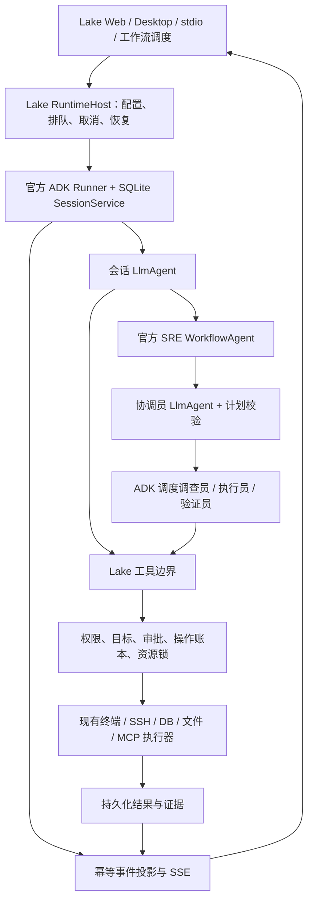

# Introduction


本方案替代 `.zcode/plans/plan-sess_5b3bcbba-5507-4fec-a756-888334739449.md` 的后续迁移安排，并接续已有 Phase 0、A/B、C0 实现。目标是让官方 ADK 负责普通聊天、SRE 四种角色、工作流与交互协议入口的模型和工具循环、工作流调度及中断恢复；Lake 负责产品数据、权限、执行器、操作账本、证据、终端与界面。

“完成”必须同时满足：所有生产 Agent 入口运行 ADK、故障恢复不重放结果不明的外部操作、旧循环及回退入口已退出、Dev 验收和目标平台 CI 有证据。安装依赖、改默认值或只抽出接口，均不构成迁移完成。

37 项实施任务与最终验收门禁均已完成；工作分支保持 `experiment/adk-runtime`，保留原有工作区。阶段状态按实际测试证据更新，未通过的门禁不得标为完成。

## 实施时的 API 核验与路径调整

- 官方 SDK 直接由 `internal/ai/adk_*.go` 托管，持久化放在无 ai 依赖的 `internal/agent/storage`；不再创建 ai→adk→ai 的循环依赖。原 scoped Engine 只保留业务状态与权限，不含旧模型循环。任务表已按实际 SDK 归属更新；最初拟定的 `internal/agent/adk` 生产文件不作为替代运行时保留。
- 使用官方公开 custom Agent wrapper 保留角色 RequestConfirmation 的 FunctionResponse；v2.6.0 Workflow AgentNode 会改写 user content，不能直接承担这个恢复边界。DAG 仍使用官方 WorkflowAgent/DynamicNode/RunNode。
- Lake 的原生 provider 历史保存在官方 artifact 和 session state 中；session event ID、投影引用/校验和及 migration index 用于幂等恢复。图片正文移入 artifact。JSON 为上下文缓存，业务操作账本保持独立权威。
- SQLite 备份采用内置 `VACUUM INTO` 一致性快照，配合 quick_check、fsync、原子替换及源文件备份，替代驱动专属 backup API。
- 上下文压缩采用 `(contextWindow-maxOutput)*3/4`（最小 1024）的 token 门限和 4 个尾部事件；模型适配器同时执行实际 provider 请求预算，继续使用 Lake 45 秒摘要期限。该值替代下文最初拟定的初始门限。
- 跨库投影采用官方 event/state 中的 artifact 版本、hash、event ID 和 migration index 检查点；恢复时重建可丢弃 JSON 缓存，明确 clear/rollback 的新投影优先。没有新增一套假定双库原子提交的事务。
- 实际文件、测试与命令映射见最终验收 JSON。平台测试中保留原断言意图：Windows 检查用户私有 ACL；Linux 使用 GNU date，dash 不发送 readline 专属 Ctrl-L；终端历史检查使用 durable history，输入保留仍检查真实命令输出。

## 1. Requirements & Constraints

- **REQ-001**: 使用官方 `google.golang.org/adk/v2@v2.6.0`，固定 Go `1.26.6`；2026-10-18 的模块查询确认该版本为 `@latest`。不修改 SDK 缓存、不使用私有 fork，不混用 Python/TypeScript 的同名 API。
- **REQ-002**: 普通会话、SRE 创建/继续/改计划/向角色提问、保存工作流与调度执行、stdio Agent 请求最终统一进入 ADK。标题生成、输入补齐、记忆提取、预设提取等无工具的单次 provider 请求可以保留为明确列举的辅助请求，不能承载工具循环。
- **REQ-003**: 每个角色均是独立官方 `llmagent`；工作流节点通过官方 `workflow` 和 `workflowagent` 调度。禁止把调用 `Engine.RunSRERole`、`Engine.ChatTurn` 或子 Engine 的函数包装成节点后宣称迁移完成。
- **REQ-004**: 保留现有模型供应商、模型选择、推理级别、图片能力、协议完成标记、usage、上下文压缩、记忆、附件引用、目标范围和操作卡片语义。provider 转换属于模型适配器；ADK 不要求将用户模型改成 Gemini。
- **REQ-005**: SRE 仍支持依赖、计划版本、计划审阅、只出计划、并行调查、执行独占、独立验证、人工确认、暂停/取消/继续和旧任务恢复。角色工具能力依据现有 `sreFullCatalog`、父权限与任务目标相交后生成，不在迁移中重新扩大权限。
- **REQ-006**: 最终运行时选择只有 ADK；迁移期保留的旧路径必须有退出任务、测试和期限。历史 `agentRuntime=go` 配置经过幂等迁移后继续可读；不能因删除下拉框而令旧会话无法发送。
- **REQ-007**: 每项验收记录运行命令、退出码、SDK/Go 版本、提交与工作区差异摘要；失败项或未运行项必须如实保留，任一阶段门禁未满足时不得标为完成。
- **REQ-008**: 迁移前使用 SQLite VACUUM INTO 一致性快照和原始业务文件备份保存当前测试实例的私有快照、schemaVersion 与迁移日志；先在隔离副本演练导入。迁移失败保留源数据并拒绝继续派发。回退前停止所有运行，保存最新操作账本并核实 dispatched/unknown；不能用执行前快照覆盖执行后的账本，也不能让旧程序读取不兼容的新 schema。回退以可兼容的已签名程序和数据版本为单位，恢复写派发必须经过账本 reconcile。
- **SEC-001**: 全部资源操作经一个 Lake 工具边界；权限拒绝必须终止，不能降级成“用户批准即可绕过”。policy 失败、目标未解析或指纹缺失时拒绝派发，不得默认判为只读。
- **SEC-002**: 审批绑定 session/task/plan revision/attempt/operation/tool、规范化参数摘要、资源与终端 generation、policy version 和有效期；恢复执行前重新检查当前权限及目标。审批使用事务原子领取，重复或并发决策最多取得一次派发权。
- **SEC-003**: 外部执行前持久化派发状态；结果丢失、超时、崩溃后保留 `unknown` 或带终端句柄的 `dispatched`，先核实原操作。不得将 SDK checkpoint、run ID、取消 context 或重试策略当作外部系统 exactly-once 保证。
- **SEC-004**: 不打印模型密钥、SSH 私钥或完整私密工具数据；凭据只从当前实例的私有存储读取。摘要、日志、测试夹具、ADK session/state、artifact 元数据均不得存入凭据；ADK 持久化前执行同一脱敏边界。
- **SEC-005**: 实际操作、审批与证据必须可关联。执行前记录失败则不派发；执行后记录失败则报告结果待核实并保留已持久化的派发状态，不能因报错自动重复执行。普通模型文本不能生成或改写执行证据。
- **CON-001**: 保留当前 `experiment/adk-runtime` 分支和所有已有工作区改动，不执行 reset、清理、批量提交。依赖与文档任务只处理本方案拥有的文件。
- **CON-002**: macOS 后端仅由 `scripts/build_lake.sh` 签名构建；本地应用仅用 `scripts/build_lake_desktop.sh --dev --install` 和 `~/Applications/Lake Dev.app`。Dev 使用 `~/.lake-dev`，隔离预览使用新的显式 `--home` 和空闲 loopback 端口，不访问或复制 release secrets。
- **CON-003**: 遵循 `docs/ui-guidelines.md`，继续使用 `AppSelect`、`Glyph`、`ProviderIcon`；迁移期运行时标记准确，最终删除业务界面的运行时选择。界面保留一个本轮状态与停止入口。
- **GUD-001**: 依赖保持固定版本。SDK 升级必须先更新能力核验和恢复测试，再更新版本；“使用官方”指使用官方公开扩展点，Lake 的 SRE 业务状态机和工具权限仍需由 Lake 实现。
- **PAT-001**: 采用官方 `Runner + SessionService + LlmAgent + Workflow`，通过公开接口接入 Lake 的模型、memory、artifact 和 plugin；不导入 SDK 的 `internal/` 包，不另写替代 ADK 的 LLM/tool 调度循环。

### 官方能力与 Lake 职责

以下 API 已核对本机官方 v2.6.0 模块源码；链接指向相同固定版本，避免追随 `main` 的接口变动。

| 领域 | 官方公开 API | Lake 实现边界 |
|---|---|---|
| 模型循环 | `agent/llmagent.New`、`model.LLM`、`runner.New` / `Runner.Run` | `LakeLLM` 转换现有 provider；统一继承会话配置及超时 |
| 工作流 | `agent/workflowagent.New`、`workflow.NewAgentNodeTyped`、`NewFunctionNode`、`NewDynamicNode`、`RunNode` | 计划校验、角色选择、依赖关系、资源锁、已完成 attempt 查询 |
| 人工交互 | 工具 `RequestConfirmation`；`workflow.NewRequestInputEvent` / `ResumeOrRequestInput`；`FunctionResponse` | 审批账本、UI 决策路由、确认指纹、任务问题与计划审阅 |
| 会话与恢复 | `session.Service`、`session/database`、官方 workflow event/run state | 稳定映射、实例隔离、幂等导入、操作结果核实、事件投影 |
| 回调与审计 | `plugin.New`、`runner.PluginConfig`、模型/工具/event callbacks | 用量、权限上下文、脱敏、日志；执行权限仍在工具边界校验 |
| 上下文 | `runner.Config.Compaction`、`session/compaction.Summarizer` | 接入 Lake 摘要规则、预算核验、45 秒期限、回退点与记忆 |
| 记忆及附件 | `memory.Service`、`artifact.Service` | 连接现有项目记忆与私有文件存储，实行项目和会话访问控制 |

### 目标执行路径



### 固定的执行规则

1. `RunIdentity` 包含 session、root turn、task、plan revision、plan run、step、attempt、role、invocation 和 operation ID；实例生成 ID，模型不能提供可信身份。ADK 分支使用任务/attempt 派生的稳定名称，序列化后恢复不变。
2. 会话根 Agent 显式设 `llmagent.ModeChat`；自动完成的 SRE 角色节点显式设 `ModeSingleTurn` 并提供输出 schema。面向用户的问题通过工作流输入节点暂停，不把“暂时没有输出”当作角色完成。
3. 每个 ready batch 最多并发 4 个只读步骤，同一角色最多一个活动步骤；`act` 步骤独占该计划调度通道，执行器的资源锁与当前终端所有权检查仍生效。取消后等待本次所有已启动节点退出再释放 session。
4. 动态编排使用 `workflow.RunNode`，并用 `WithUseSubBranch` / `WithIsolationScope` 隔离兄弟角色历史。`WithRunID` 只用于稳定节点身份与同次 activation 去重；v2.6.0 的 `workflow/run_node.go` 明示不能依赖它跨 HITL 暂停去重。恢复时先查持久化的 attempt/operation，再决定返回已存结果、恢复等待或启动新 attempt。
5. 所有有副作用的节点 `NodeConfig.RetryConfig=nil`；只读采样也默认不自动重跑整段角色循环。仅对确认尚未产生有效模型事件、尚未派发工具的临时 provider 失败重试，最多 2 次额外尝试，受父请求期限约束。
6. 并行分支的等待项按 `approvalID` 或 `interruptID` 保存为集合，不能沿用单个 `sink.Pending` 槽覆盖另一分支。工具确认与工作流问题使用不同 `kind`，按作者、分支、invocation 和原始 call/interrupt ID 恢复。
7. ADK event history 是模型/工作流历史来源；Lake Store 的消息与卡片是界面投影；SRERepository 是计划、attempt、operation、验收与业务授权的来源；项目记忆仍是现有记忆库。双库不假定共享事务，使用持久化事件 ID、artifact 版本/hash、migration index、投影 cursor 和幂等 reconcile 修复中断。
8. 普通上下文上限为当前 `contextWindow`，单轮模型调用额度采用当前 `maxSteps`，单次输出采用 `maxOutput`；累计任务预算沿用现有 SRE 预算算法并持久化，不随暂停/恢复清零。ADK 无法直接表达的额度由公开 model/plugin 边界强制执行。
9. compaction 显式提供 Lake `Summarizer`，因为根 Agent 可能是 workflow；先关闭周期压缩，仅启用按预算压缩。`TokenThreshold=max(1024, (contextWindow-maxOutput)*3/4)`，`EventRetentionSize=4` 作为尾部保留值；每次模型请求前仍对系统提示、工具 schema、图片和保留事件做实际 provider 预算检查，尾部过大时拒绝本次请求并保留原始历史，不静默裁掉用户约束。
10. 任务成功由计划步骤结果和服务器计算的验收结果决定。模型 final、Runner 迭代结束、收到 `done` 或 HTTP 连接关闭，均不能独自将 SRE 任务标为成功；取消、待审批和结果不明具有更高优先级。

## 2. Implementation Steps

所有相位按编号顺序执行；每相位内未标出额外依赖的任务仅在文件和行为相互独立时可并行处理。该说明不要求启动子 Agent。阶段失败则修复当前阶段，不跳过门禁、不用剩余预算作为完成依据。

### Implementation Phase 0 — 官方依赖、现状与验收基线

- **GOAL-001**: 固定官方依赖，并建立可验证的迁移清单。完成标准：安装核验、能力清单、入口清单和基线测试结果均有记录。

| Task | Description | Completed | Date |
|------|-------------|-----------|------|
| TASK-001 | 在当前仓库执行 `go list -m -json google.golang.org/adk/v2@latest`、`go get google.golang.org/adk/v2@v2.6.0`、`go mod download google.golang.org/adk/v2@v2.6.0`、`go mod verify`；确认 Go 1.26.6，安装前后 go.mod/go.sum 哈希一致。记录到 `docs/validation/lake-adk-official-baseline.json`。 | ✅ | 2026-10-18 |
| TASK-002 | 核对官方 v2.6.0 的 llmagent、runner、workflow、workflowagent、plugin、session/database、memory、artifact、compaction 源码；将实际可用 API、恢复限制与职责记录在本文件，避免套用其他语言教程。 | ✅ | 2026-10-18 |
| TASK-003 | 执行 `go test -race ./internal/agent/adk ./internal/web -run 'TestGate\|TestFileApproval\|TestFileEvidence\|TestEvidence\|TestRuntime\|TestLakeLLM\|TestLakeRequest\|TestADKRuntime' -count=1`；只将该选择器覆盖的既有测试记为通过，不把它写成 SRE 迁移验收通过。 | ✅ | 2026-10-18 |
| TASK-004 | 建立入口覆盖 JSON；记录完整 Go/前端基线，保留原断言并在最终实现上再次执行。 | ✅ | 2026-10-18 |

### Implementation Phase 1 — 拆分业务能力与旧模型循环

- **GOAL-002**: ADK 直接复用 Lake 业务能力而不依赖旧角色运行时。依赖 Phase 0；完成标准：新边界可独立测试，业务宿主接口不包含运行旧模型循环的方法。

| Task | Description | Completed | Date |
|------|-------------|-----------|------|
| TASK-005 | 在 `internal/ai/runtime_contract.go` 定义 RunIdentity、RuntimeCheckpoint、RuntimeInput/RoleInput/RuntimeEvent；通过有效 Config 和 RuntimeCapabilities 解析宿主能力。SDK 直接由 ai 托管，避免 ai→adapter→ai 循环。 | ✅ | 2026-10-18 |
| TASK-006 | 在 `adk_sre_roles.go`、`agent_scope.go`、`agent_role_catalog.go` 中保留角色 prompt、权限交集、证据和预算；scoped Engine 只承载业务状态，角色模型/工具循环由官方 Runner/LlmAgent 执行。 | ✅ | 2026-10-18 |
| TASK-007 | 抽取 `agent_runs.go`、`agent_evidence_records.go`、`provider_runtime.go`、`adk_observation_roles.go`；删除原 `multi_agent.go` 模型循环，保留操作与证据产品能力。 | ✅ | 2026-10-18 |
| TASK-008 | 实现纯 `sre_checks.go:EvaluateSREChecks`；计算冻结采样、成功来源、目标、新鲜度、比较、时间窗和样本数。SRE 验证员仍独立采样，模型文字不能替代验收。 | ✅ | 2026-10-18 |
| TASK-009 | 以权限/目标测试及 AST 边界检查验证新宿主；禁止生产代码调用已退役的 ChatTurn、RunSRERole、旧调度和 prototype runtime。 | ✅ | 2026-10-18 |

### Implementation Phase 2 — 普通会话完整适配

- **GOAL-003**: 在非 SRE 会话中完整保持现有行为。依赖 Phase 1；完成标准：功能矩阵、协议异常与取消测试通过，模型配置和历史均来自当前会话。

| Task | Description | Completed | Date |
|------|-------------|-----------|------|
| TASK-010 | 用 `adk_model.go` 和 `adk_provider_step.go` 接入有效会话模型、provider 协议、reasoning、usage、图片、引用与实际上下文预算；provider step 仅执行单次请求。 | ✅ | 2026-10-18 |
| TASK-011 | 在 `adk_driver.go` 使用官方 Runner/LlmAgent、公开 callbacks、session/plugin/memory/artifact/compaction services 和顺序 tool task runner；角色节点仍可并行。 | ✅ | 2026-10-18 |
| TASK-012 | 在 `adk_services.go` 实现持久 memory/artifact service，接入项目权限和私有附件；图片使用 artifact/FileData 引用，版本及访问限制有回归。 | ✅ | 2026-10-18 |
| TASK-013 | 在 `adk_projection.go` 接入官方 Compaction 与 Lake Summarizer、45 秒摘要期限和请求预算；clear/restore/rollback 发布新官方投影，缓存丢失不会恢复已清除上下文。 | ✅ | 2026-10-18 |
| TASK-014 | 保留并运行 provider/图片/stream/usage/结束标记/预算/取消等既有协议断言，并扩充官方服务和产品 ADK 集成测试；使用本地 provider 检查真实请求。 | ✅ | 2026-10-18 |

### Implementation Phase 3 — 真正的 ADK SRE 只读纵向切片

- **GOAL-004**: coordinator、investigator、verifier 都由官方 LlmAgent 执行。依赖 Phase 2；完成标准：从产品 SRE 入口到独立验收全部经过 ADK，旧角色循环不可达。

| Task | Description | Completed | Date |
|------|-------------|-----------|------|
| TASK-015 | 四种 SRE 角色使用独立官方 LlmAgent、ModeSingleTurn、角色 prompt/目录/输出约束。公开 custom agent wrapper 保留 confirmation 响应，绕过 v2.6 AgentNode 的 user-content 改写限制。 | ✅ | 2026-10-18 |
| TASK-016 | 计划生成通过官方角色 Runner；校验/验收保留纯业务实现。`adk_sre_workflow.go` 用官方 WorkflowAgent 表达执行 DAG，plan_only 与人工审阅使用独立 RequestInput checkpoint。 | ✅ | 2026-10-18 |
| TASK-017 | 用官方 DynamicNode/RunNode、稳定 branch/isolation 调度校验后的 DAG：最多 4 并发、同角色单通道、act 独占、依赖完成、取消排空、持久 attempt 复用。 | ✅ | 2026-10-18 |
| TASK-018 | Web SRE 创建、继续、改计划、角色提问及聊天 handoff 统一进入 ai 的官方 SDK 宿主；不再注入旧运行时或在线双跑资源操作。 | ✅ | 2026-10-18 |
| TASK-019 | 在保留基线业务断言的 ADK 默认 fixture 上验证 DAG、计划约束、权限范围、证据、独立验收、plan_only 零派发和产品状态；静态检查证明旧循环不可达。 | ✅ | 2026-10-18 |

### Implementation Phase 4 — 审批、外部执行与故障恢复

- **GOAL-005**: 写操作及所有等待都能安全恢复。依赖 Phase 3；完成标准：拒绝、竞态、崩溃窗口与恢复场景全部通过，外部效果不会因工作流重新进入而重复派发。

| Task | Description | Completed | Date |
|------|-------------|-----------|------|
| TASK-020 | `tools.go` 对 policy 错误/未知指纹失败关闭；`adk_approval.go`、`adk_operations.go`、共享 SQLite 保存审批/账本/审计，审批消费与 dispatched 领取同事务。 | ✅ | 2026-10-18 |
| TASK-021 | 工具使用官方 RequestConfirmation；持久原 call/author/branch/invocation 和绑定摘要，客户端只能提交原 ID/决定。恢复时复核权限、目标、generation、计划/attempt 与有效期。 | ✅ | 2026-10-18 |
| TASK-022 | SRE 与普通聊天共享 canonical operation ID 和派发纪律；外部执行前写 dispatched，结果失败/丢失留 unknown，SRE operation 为业务投影，不能靠 checkpoint 自动重放。 | ✅ | 2026-10-18 |
| TASK-023 | `adk_questions.go` 使用官方 WorkflowAgent RequestInput/ResumeOrRequestInput 保存澄清、计划审阅和人工验收；恢复原 FunctionResponse，不伪造用户审阅或重发未完成的其他调用。 | ✅ | 2026-10-18 |
| TASK-024 | `adk_recovery.go` 从持久记录重建 Runner/角色等待。跨库投影未完成时核对当前 plan/role/attempt/operation 后修复原等待，已派发/已结算操作拒绝重放；取消等待全部子任务退出。 | ✅ | 2026-10-18 |
| TASK-025 | 通过真实进程崩溃、并发审批、外部 append、派发后结果丢失、审计失败、权限变化及人工核实测试；新增审批/问题在业务等待投影前崩溃的确定性回归，保持原 run/attempt。 | ✅ | 2026-10-18 |

### Implementation Phase 5 — 历史迁移、事件与产品界面

- **GOAL-006**: 旧会话可继续，所有状态可由持久记录恢复。依赖 Phase 4；完成标准：迁移幂等、刷新恢复稳定、无审批丢失或重复消息。

| Task | Description | Completed | Date |
|------|-------------|-----------|------|
| TASK-026 | `adk_migration.go` 幂等导入旧历史并保存 completion marker；SQLite VACUUM INTO + quick_check/fsync/原子替换及源 JSON 私有备份；中断导入不激活，历史调用从不执行。 | ✅ | 2026-10-18 |
| TASK-027 | 官方 session state/artifact 保存 lossless provider 历史、版本/hash/event ID；migration index 和 cursor 支持缓存恢复。生命周期区分等待、取消、失败和完成，结果不明不能升级为成功。 | ✅ | 2026-10-18 |
| TASK-028 | AIPanel、AgentQuestion、AgentTaskList、SRERoleMessage 展示待审批集合、角色问题和 unknown 人工核实；最终移除 runtime 选择，复用 AppSelect/Glyph/ProviderIcon。 | ✅ | 2026-10-18 |
| TASK-029 | 运行多轮历史、缓存丢失、导入重试、项目权限、artifact、审批和取消回归；在隔离 Dev/loopback fixture 验证宽屏、390px、暗色、问题回答与无重复写入，并保存截图。 | ✅ | 2026-10-18 |

### Implementation Phase 6 — 所有入口切换与 Dev 验收

- **GOAL-007**: 生产入口均由 ADK 执行，保留数据兼容而不保留隐式旧执行。依赖 Phase 5；完成标准：入口清单没有遗留旧 runtime，完整回归与 Dev 演示通过。

| Task | Description | Completed | Date |
|------|-------------|-----------|------|
| TASK-030 | stdio Handle(chat)、ChatWorkflow、保存工作流和调度共用 ExecuteTurn/官方角色宿主；确定性脚本继续使用已有执行器。签名 CLI 的实际 JSON stdio 配置/聊天验收通过。 | ✅ | 2026-10-18 |
| TASK-031 | Web/Server/SRE 全部收敛至官方 SDK；删除 Go fallback。旧 agentRuntime=go 选项规范化为 adk 并保留迁移来源，历史、模型和权限继续可读。 | ✅ | 2026-10-18 |
| TASK-032 | 冻结实现后完成完整 Go/race/vet、前端测试/类型/构建、静态边界及产品 fixture；执行真实 Linux/Windows/macOS CI，并记录命令、退出码、源码快照与失败修复。 | ✅ | 2026-10-18 |
| TASK-033 | 用指定签名脚本构建/安装 Lake Dev，独立 home/data 完成审批、拒绝、问题、恢复 GUI；测量签名二进制体积/进程启动并与隔离导出的 pre-ADK HEAD 比较，演练当前账本兼容恢复和签名兼容版本回退。 | ✅ | 2026-10-18 |

### Implementation Phase 7 — 删除旧运行时与交付门禁

- **GOAL-008**: 代码、配置、文档和测试共同证明旧运行时已退出。依赖 Phase 6；完成标准：删除后完整回归再次通过，仓库中没有旧工具循环可供产品调用。

| Task | Description | Completed | Date |
|------|-------------|-----------|------|
| TASK-034 | 删除 Engine 内旧模型/工具循环、multi_agent.go、旧角色/调度文件；保留业务状态转换、配置、执行器、卡片和证据，角色实际循环全部属于 SDK。 | ✅ | 2026-10-18 |
| TASK-035 | 删除旧 SREHost/external/web runtime adapter、spike 命令及回退开关；原 prototype 的行为断言仅保存在测试 fixture，生产只保留公开模型 adapter 别名。 | ✅ | 2026-10-18 |
| TASK-036 | 产品 fixture 默认运行 ADK；Python 启动的 Go AST 边界检查拒绝退役循环、prototype 生产引用和 SDK internal import，单次辅助 provider 请求使用显式 allowlist。 | ✅ | 2026-10-18 |
| TASK-037 | 更新运行说明、贡献流程、SRE 文档、Go/SDK notices 和原生 CI；最终验收 JSON 包含所有入口、功能、崩溃窗口、实际文件、签名 Dev、平台结果与截图，门禁通过后标 Completed。 | ✅ | 2026-10-18 |

## 3. Alternatives

- **ALT-001**: 保持“ADK 聊天 → Go SRE handoff”。接入成本低，但依然存在两套模型循环与恢复语义，不满足全量替换；仅作为当前基线记录。
- **ALT-002**: 把 `SREHost.RunSRERole` 封装成 FunctionNode。节点外形符合 ADK，内部仍调用 child.Chat，无法收敛权限、history 与恢复，因此不采用。
- **ALT-003**: 将所有业务改为 Python ADK 或单独部署 ADK Web。会增加本地打包、进程通信和凭据边界；Lake 已有 Go backend 与产品 UI，选择官方 Go SDK 嵌入。ADK Web 只适合隔离开发调试，不作为产品入口。
- **ALT-004**: 仅使用固定 SequentialAgent/ParallelAgent。只读固定演示可用，但计划依赖、改计划和多种等待需要动态决策；选择 WorkflowAgent + 官方 dynamic workflow，保留代码实现的业务约束。
- **ALT-005**: 在线双跑两个 runtime。重复采样可能改变观察窗口，写操作更不可接受；仅对本地 fixture 做独立对照，真实请求只执行一个 runtime。
- **ALT-006**: 在第一步删除所有旧代码。会丢失还未抽取的证据、权限、history 和专员可视化能力；选择逐阶段迁移，在最终门禁前保留有期限的测试对照，最后明确删除。

## 4. Dependencies

- **DEP-001**: 官方 ADK Go v2.6.0、Go 1.26.6、genai v1.74.0 与当前 go.sum；本次已完成安装/校验，版本升级须重新验收。
- **DEP-002**: Lake `internal/ai` 的 provider、工具 schema、权限判断、证据和 SRERepository 事务；先拆除对 agentWorker/旧循环的隐式依赖，再复用。
- **DEP-003**: `internal/agent/storage/sqlite.go` 装配的官方 database service 与 SQLite；审批/操作账本使用独立自有表，通过公开 API 使用 SDK，不能直接依赖 SDK 私有表结构。
- **DEP-004**: Web Store/SSE、项目记忆、私有附件目录、终端 generation/所有权和可观察操作句柄；这些业务数据需有稳定身份及实例隔离。
- **DEP-005**: 本机 Node/pnpm、已有前端测试、macOS 签名身份与 Dev 构建脚本；Windows/Linux 实际 CI 成功后才记录为通过，本机不能替代目标平台结果。

## 5. Files

- **FILE-001**: `go.mod`、`go.sum`、三套 CI workflow：固定官方 ADK/Go/genai/GORM 与现有 modernc SQLite；记录原生跨平台验证。
- **FILE-002**: `internal/agent/adk/model.go` 是共享公开模型 adapter 别名；原 spike 的 runtime/gate/session/tools/config 仅在 `prototype_*_test.go` 中保留回归。
- **FILE-003**: `internal/ai/adk_{driver,model,provider_step,session,services,projection,approval,operations,evidence,outcomes,migration,recovery,questions,lifecycle,sre_roles,sre_workflow}.go`：官方 SDK 宿主和产品边界。
- **FILE-004**: `internal/ai/{runtime_contract,agent_scope,agent_runs,agent_role_catalog,agent_evidence_records,provider_runtime,sre_checks}.go` 与 `internal/agent/storage/sqlite.go`：身份、业务能力、纯验收和共享存储。
- **FILE-005**: 保留 Engine/SRE orchestrator/execution/verification/workflow/stdio 的业务功能；删除 `multi_agent.go`、旧 `sre_host.go`、旧角色循环/调度、external adapter 和 spike 命令。
- **FILE-006**: `internal/web/{agent,server,sre_store,sre_service}.go` 直接装配统一 Engine/SDK 宿主；既有 SRE routes、工作流与调度复用该路径。旧 web/adk_runtime.go 退出生产。
- **FILE-007**: `web-agent/shared/contracts.ts` 和 AIPanel/AgentQuestion/AgentTaskList/SRERoleMessage/agentTasks：待审批集合、角色问答、unknown 核实和进度。
- **FILE-008**: `internal/ai/adk_*_test.go`、`internal/web/adk_runtime_test.go`、`adk_role_recovery_test.go`、保留的 SRE/provider/workflow fixture、AST 边界检查及原生 CI。
- **FILE-009**: 本计划、ADK/SRE 运行说明、CONTRIBUTING、依赖 notices/licenses、覆盖清单、最终验收 JSON 和隔离 GUI 截图。

## 6. Testing

- **TEST-001**: 安装基线：固定版本查询、`go mod verify` 和官方 adapter/gate/runtime/web 集成 race 测试；结果在 `lake-adk-official-baseline.json`。这仅证明现有安装与适配基础，不涵盖未实现的工作流。
- **TEST-002**: provider/会话兼容：逐协议验证真实 request/stream/call ID/usage/finish marker，模型配置继承、图片、上下文预算、无效 tool schema、断流与取消；纯文本返回不能遮蔽工具解析错误。
- **TEST-003**: 权限与资源：本机禁止、未授权资源、项目隔离、目录/文件引用、终端 adoption/generation、父权限变化、MCP 与保存工作流嵌套调用；policy 拒绝及错误均零派发。
- **TEST-004**: SRE DAG：并行读步骤在本地 barrier 上同时进入，act 步骤不与任何其他步骤重叠；依赖顺序、同角色并发上限、兄弟 history 隔离、token 结算及取消排空具有可观测断言。
- **TEST-005**: 独立验收：冻结 probe、实际成功证据 ID、最小样本数、观察时间窗、动作后的证据新鲜度、资源范围、人工确认和 inconclusive 不被模型措辞升级。
- **TEST-006**: 故障注入：覆盖 TASK-025 全部窗口；模拟 SDK 动态节点重新进入、SDK 重试和重复事件，对真实临时 append 计数及持久 operation 状态断言。目标是禁止自动重复派发；不声称跨任意 SSH/DB 系统严格 exactly-once。
- **TEST-007**: 数据迁移与恢复：两次导入、导入中断、服务进程重启、旧 go 配置、旧审批失效、unknown 操作核实、多个等待项、多轮消息、角色问答、rollback/clear/compact 与断线重连。
- **TEST-008**: 产品与静态边界：从 HTTP/SSE、stdio 和调度实际进入 ADK；检查 frontend 主题/窄屏、唯一停止/计时状态、tool 卡片不重复、内部分支正文不覆盖主回复，以及最终旧运行时代码不存在。
- **TEST-009**: 全量命令按下方固定顺序执行并保存退出码；失败修复后仅重跑受影响阶段，最终删除旧实现后必须完整重跑一次。
- **TEST-010**: 目标平台：macOS 签名 Dev 实测，Windows 与 Linux CI 执行适配后的安装/编译/恢复 smoke；依赖纯 Go SQLite 与现有跨平台终端实现，禁止以交叉编译成功代替平台运行测试。

```bash
go mod verify
go test ./...
go test -race ./internal/agent/... ./internal/ai ./internal/web
go vet ./...
pnpm --dir web-agent test:frontend
pnpm --dir web-agent check
pnpm --dir web-agent build:web
python3 scripts/check_adk_runtime_boundary.py
scripts/build_lake.sh
scripts/build_lake_desktop.sh --dev --install
```

上述命令是后续实现门禁，当前尚未全部执行；最终脚本须在 TASK-036 创建后运行。Dev 安装与启动遵守 CON-002；独立 Web 验证须使用该测试专有 `--home` 和实际探测的空闲端口。

### 最终交付判定

| 判定项 | 通过条件 | 当前状态 |
|---|---|---|
| 官方安装 | 固定版本下载、校验、现有集成测试通过 | 已验证 |
| 聊天兼容 | 所有 provider/上下文/附件/工具/取消行为矩阵通过 | 待实施与验证 |
| SRE 全量 | 四角色、planner、独立验证及调度均走 ADK | 未完成 |
| 审批恢复 | 双分支、并发决策、权限变化、进程重启通过 | 未完成 |
| 外部操作 | 崩溃/超时后无自动重复派发，unknown 可核实 | 未完成 |
| 数据兼容 | 旧会话/配置/任务幂等迁移并可继续 | 未完成 |
| 全入口 | Web、stdio、工作流/定时执行覆盖清单全部 ADK | 未完成 |
| 旧实现退出 | 生产源码没有旧模型工具循环和 Go fallback | 未完成 |
| 平台交付 | macOS Dev + Windows/Linux 目标环境证据齐全 | 未执行 |

## 7. Risks & Assumptions

- **RISK-001**: SDK workflow 恢复与产品操作状态并不构成单一分布式事务。使用 canonical operation 账本、预派发持久化、outbox/reconcile 与结果核实；无法确认的窗口停止写派发。
- **RISK-002**: 当前 `SREHost` 复用会把旧模型循环带回新图；TASK-006 拆开接口，TASK-009、TASK-019、TASK-036 检查调用边界。
- **RISK-003**: 当前 `webADKSink` 单正文/单 pending 假设不适合多角色；TASK-027–TASK-029 按分支投影且持久恢复，不能只增加一个 goroutine。
- **RISK-004**: ADK event、工具 schema 与 artifact 可能增加 prompt 和磁盘量；每次发送前核验实际预算，摘要保留来源，usage 未知不记为零。发布前记录签名体积、启动开销及历史增长样本。
- **RISK-005**: 当前测试 fixture 显式走 Go，既有全绿不能证明 ADK 行为完整。最终必须迁移产品 fixture，并保留针对关键资源/恢复语义的行为断言。
- **RISK-006**: 新旧文档已有互相矛盾的默认值、图片与审批说明；本方案作为后续验收依据，历史 phase 记录保留时间语境，当前状态文档只保留一个准确结论。
- **RISK-007**: v2.6.0 的公开 API 不等于 Python 全部配套能力。需要的能力若缺少 Go 公开接口，阶段状态写为失败或待解决，记录最小 adapter 实现；不从 SDK internal 包绕过，也不悄悄保留旧 Agent 循环。
- **ASSUMPTION-001**: 当前请求采用官方 Go ADK 路线，保留 Lake Go backend、现有供应商及产品界面；不额外引入 Python 服务或要求 Gemini 密钥。
- **ASSUMPTION-002**: 外部服务器未提供统一幂等键协议，故承诺自动恢复不重复派发及结果不明时阻断，而不是不可证明的跨系统 exactly-once。
- **ASSUMPTION-003**: 本轮制定方案和核验依赖，不部署新的运行时，不操作线上资源，不发布 release；后续实施按本文件阶段和门禁推进。

## 8. Related Specifications / Further Reading

本地背景：[现有 ADK 实验](../docs/experiments/adk-runtime.md)、[C0 验证](../docs/validation/lake-adk-phase4.md)、[既有 SRE 完整运行时](refactor-sre-agent-runtime-1.md)、[SRE 协作说明](../docs/sre-collaboration.md)、[本地开发约束](../CONTRIBUTING.md)、[UI 规范](../docs/ui-guidelines.md)。

官方文档（2026-10-18 核对）：

- [ADK Go 安装与官方仓库](https://github.com/google/adk-go#-installation)：确认模块路径及嵌入 Go 的安装方式。
- [ADK Go v2.6.0 release](https://github.com/google/adk-go/releases/tag/v2.6.0)：版本基线。
- [Graph workflows](https://adk.dev/graphs/) 与 [Dynamic workflows](https://adk.dev/graphs/dynamic/)：官方 graph/dynamic workflow 的能力与 Go 示例。
- [Action confirmations](https://adk.dev/tools-custom/confirmation/) 与 [Human input](https://adk.dev/graphs/human-input/)：工具确认与工作流输入的不同用途。
- [Session service](https://adk.dev/sessions/session/)、[Plugins](https://adk.dev/plugins/) 与 [Resume agents](https://adk.dev/runtime/resume/)：服务与回调的概念；具体 Go 支持以固定版本公开源码为准。

固定版本源码（实现依据）：

- [LlmAgent 与 mode/schema](https://github.com/google/adk-go/blob/v2.6.0/agent/llmagent/llmagent.go)、[Runner services 与 Compaction](https://github.com/google/adk-go/blob/v2.6.0/runner/runner.go)。
- [WorkflowAgent 的恢复入口](https://github.com/google/adk-go/blob/v2.6.0/agent/workflowagent/workflow.go)、[dynamic node](https://github.com/google/adk-go/blob/v2.6.0/workflow/dynamic_node.go)。
- [RunNode / WithRunID 的恢复限制](https://github.com/google/adk-go/blob/v2.6.0/workflow/run_node.go)、[NodeConfig 重试与恢复语义](https://github.com/google/adk-go/blob/v2.6.0/workflow/config.go)、[RequestInput](https://github.com/google/adk-go/blob/v2.6.0/workflow/request_input.go)。
- [公开 plugin callbacks](https://github.com/google/adk-go/blob/v2.6.0/plugin/plugin.go)、[Compaction 配置与 Summarizer](https://github.com/google/adk-go/blob/v2.6.0/session/compaction/compaction.go)。

## 最终验收记录（2026-10-18）

本机完整 Go/race/vet、200 项前端测试、类型检查、构建、静态边界、签名 CLI/Dev、Swift 与安装器验证均通过；Linux 全量回归及 Windows 原生 SDK/恢复/编译 CI、macOS 全量 race CI 均通过。测试代码快照 `02bd67b55d19d560a7eb73c63f832b974f7cfa14` 位于 `codex/adk-runtime-acceptance`，当前分支及原有工作区保持不变。正式 release 应用和数据未参与测试。

最终命令退出码、源码摘要、实际文件映射、进程崩溃恢复、GUI 截图和兼容回退演练见 [最终验收 JSON](../docs/validation/lake-adk-runtime-final.json)。原表中的拟定路径以本文 API 调整与 JSON 中 `taskImplementationMapping` 为准。
