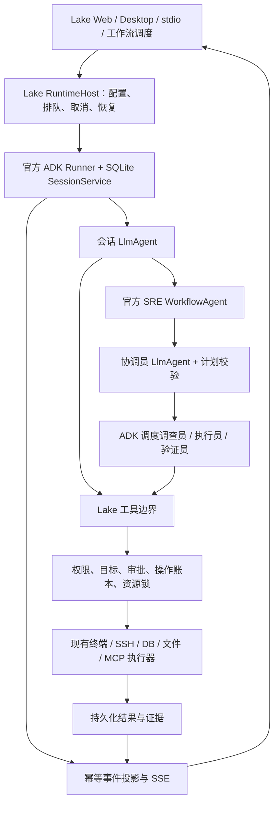

# Introduction


本方案替代 `.zcode/plans/plan-sess_5b3bcbba-5507-4fec-a756-888334739449.md` 的后续迁移安排，并接续已有 Phase 0、A/B、C0 实现。目标是让官方 ADK 负责普通聊天、SRE 四种角色、工作流与交互协议入口的模型和工具循环、工作流调度及中断恢复；Lake 负责产品数据、权限、执行器、操作账本、证据、终端与界面。

“完成”必须同时满足：所有生产 Agent 入口运行 ADK、故障恢复不重放结果不明的外部操作、旧循环及回退入口已退出、Dev 验收和目标平台 CI 有证据。安装依赖、改默认值或只抽出接口，均不构成迁移完成。

已进入完整实施；工作分支保持 `experiment/adk-runtime`，保留原有工作区。阶段状态按实际测试证据更新，未通过的门禁不得标为完成。

## 实施时的 API 核验与路径调整

- 官方 SDK 直接由 `internal/ai/adk_*.go` 托管，持久化放在无 ai 依赖的 `internal/agent/storage`；不再创建 ai→adk→ai 的循环依赖。原 scoped Engine 只保留业务状态与权限，不含旧模型循环。下表中最初拟定的 `internal/agent/adk` 生产文件，以该实际归属为准。
- 使用官方公开 custom Agent wrapper 保留角色 RequestConfirmation 的 FunctionResponse；v2.6.0 Workflow AgentNode 会改写 user content，不能直接承担这个恢复边界。DAG 仍使用官方 WorkflowAgent/DynamicNode/RunNode。
- Lake 的原生 provider 历史保存在官方 artifact 和 session state 中；session event ID、投影引用/校验和及 migration index 用于幂等恢复。图片正文移入 artifact。JSON 为上下文缓存，业务操作账本保持独立权威。
- SQLite 备份采用内置 `VACUUM INTO` 一致性快照，配合 quick_check、fsync、原子替换及源文件备份，替代驱动专属 backup API。
- 上下文压缩采用 `(contextWindow-maxOutput)*3/4`（最小 1024）的 token 门限和 4 个尾部事件；模型适配器同时执行实际 provider 请求预算，继续使用 Lake 45 秒摘要期限。该值替代下文最初拟定的初始门限。
- 跨库投影采用官方 event/state 中的 artifact 版本、hash、event ID 和 migration index 检查点；恢复时重建可丢弃 JSON 缓存，明确 clear/rollback 的新投影优先。没有新增一套假定双库原子提交的事务。
- 实际文件、测试与命令映射见最终验收 JSON。平台测试中保留原断言意图：Windows 检查用户私有 ACL；Linux 使用 GNU date，dash 不发送 readline 专属 Ctrl-L；终端历史检查使用 durable history，输入保留仍检查真实命令输出。

## 1. Requirements & Constraints

- **REQ-001**: 使用官方 `google.golang.org/adk/v2@v2.6.0`，固定 Go `1.26.6`；2026-10-18 的模块查询确认该版本为 `@latest`。不修改 SDK 缓存、不使用私有 fork，不混用 Python/TypeScript 的同名 API。
- **REQ-002**: 普通会话、SRE 创建/继续/改计划/向角色提问、保存工作流与调度执行、stdio Agent 请求最终统一进入 ADK。标题生成、输入补齐、记忆提取、预设提取等无工具的单次 provider 请求可以保留为明确列举的辅助请求，不能承载工具循环。
- **REQ-003**: 每个角色均是独立官方 `llmagent`；工作流节点通过官方 `workflow` 和 `workflowagent` 调度。禁止把调用 `Engine.RunSRERole`、`Engine.ChatTurn` 或子 Engine 的函数包装成节点后宣称迁移完成。
- **REQ-004**: 保留现有模型供应商、模型选择、推理级别、图片能力、协议完成标记、usage、上下文压缩、记忆、附件引用、目标范围和操作卡片语义。provider 转换属于模型适配器；ADK 不要求将用户模型改成 Gemini。
- **REQ-005**: SRE 仍支持依赖、计划版本、计划审阅、只出计划、并行调查、执行独占、独立验证、人工确认、暂停/取消/继续和旧任务恢复。角色工具能力依据现有 `sreFullCatalog`、父权限与任务目标相交后生成，不在迁移中重新扩大权限。
- **REQ-006**: 最终运行时选择只有 ADK；迁移期保留的旧路径必须有退出任务、测试和期限。历史 `agentRuntime=go` 配置经过幂等迁移后继续可读；不能因删除下拉框而令旧会话无法发送。
- **REQ-007**: 每项验收记录运行命令、退出码、SDK/Go 版本、提交与工作区差异摘要；失败项或未运行项必须如实保留，任一阶段门禁未满足时不得标为完成。
- **REQ-008**: 迁移前使用 SQLite backup API 和原始业务文件备份保存当前测试实例的私有快照、schemaVersion 与迁移日志；先在隔离副本演练导入。迁移失败保留源数据并拒绝继续派发。回退前停止所有运行，保存最新操作账本并核实 dispatched/unknown；不能用执行前快照覆盖执行后的账本，也不能让旧程序读取不兼容的新 schema。回退以可兼容的已签名程序和数据版本为单位，恢复写派发必须经过账本 reconcile。
- **SEC-001**: 全部资源操作经一个 Lake 工具边界；权限拒绝必须终止，不能降级成“用户批准即可绕过”。policy 失败、目标未解析或指纹缺失时拒绝派发，不得默认判为只读。
- **SEC-002**: 审批绑定 session/task/plan revision/attempt/operation/tool、规范化参数摘要、资源与终端 generation、policy version 和有效期；恢复执行前重新检查当前权限及目标。审批使用事务原子领取，重复或并发决策最多取得一次派发权。
- **SEC-003**: 外部执行前持久化派发状态；结果丢失、超时、崩溃后保留 `unknown` 或带终端句柄的 `dispatched`，先核实原操作。不得将 SDK checkpoint、run ID、取消 context 或重试策略当作外部系统 exactly-once 保证。
- **SEC-004**: 不打印模型密钥、SSH 私钥或完整私密工具数据；凭据只从当前实例的私有存储读取。摘要、日志、测试夹具、ADK session/state、artifact 元数据均不得存入凭据；ADK 持久化前执行同一脱敏边界。
- **SEC-005**: 实际操作、审批与证据必须可关联。执行前记录失败则不派发；执行后记录失败则报告结果待核实并保留已持久化的派发状态，不能因报错自动重复执行。普通模型文本不能生成或改写执行证据。
- **CON-001**: 保留当前 `experiment/adk-runtime` 分支和所有已有工作区改动，不执行 reset、清理、批量提交。依赖与文档任务只处理本方案拥有的文件。
- **CON-002**: macOS 后端仅由 `scripts/build_lake.sh` 签名构建；本地应用仅用 `scripts/build_lake_desktop.sh --dev --install` 和 `~/Applications/Lake Dev.app`。Dev 使用 `~/.lake-dev`，隔离预览使用新的显式 `--home` 和空闲 loopback 端口，不访问或复制 release secrets。
- **CON-003**: 遵循 `docs/ui-guidelines.md`，继续使用 `AppSelect`、`Glyph`、`ProviderIcon`；迁移期运行时标记准确，最终删除业务界面的运行时选择。界面保留一个本轮状态与停止入口。
- **GUD-001**: 依赖保持固定版本。SDK 升级必须先更新能力核验和恢复测试，再更新版本；“使用官方”指使用官方公开扩展点，Lake 的 SRE 业务状态机和工具权限仍需由 Lake 实现。
- **PAT-001**: 采用官方 `Runner + SessionService + LlmAgent + Workflow`，通过公开接口接入 Lake 的模型、memory、artifact 和 plugin；不导入 SDK 的 `internal/` 包，不另写替代 ADK 的 LLM/tool 调度循环。

### 官方能力与 Lake 职责

以下 API 已核对本机官方 v2.6.0 模块源码；链接指向相同固定版本，避免追随 `main` 的接口变动。

| 领域 | 官方公开 API | Lake 实现边界 |
|---|---|---|
| 模型循环 | `agent/llmagent.New`、`model.LLM`、`runner.New` / `Runner.Run` | `LakeLLM` 转换现有 provider；统一继承会话配置及超时 |
| 工作流 | `agent/workflowagent.New`、`workflow.NewAgentNodeTyped`、`NewFunctionNode`、`NewDynamicNode`、`RunNode` | 计划校验、角色选择、依赖关系、资源锁、已完成 attempt 查询 |
| 人工交互 | 工具 `RequestConfirmation`；`workflow.NewRequestInputEvent` / `ResumeOrRequestInput`；`FunctionResponse` | 审批账本、UI 决策路由、确认指纹、任务问题与计划审阅 |
| 会话与恢复 | `session.Service`、`session/database`、官方 workflow event/run state | 稳定映射、实例隔离、幂等导入、操作结果核实、事件投影 |
| 回调与审计 | `plugin.New`、`runner.PluginConfig`、模型/工具/event callbacks | 用量、权限上下文、脱敏、日志；执行权限仍在工具边界校验 |
| 上下文 | `runner.Config.Compaction`、`session/compaction.Summarizer` | 接入 Lake 摘要规则、预算核验、45 秒期限、回退点与记忆 |
| 记忆及附件 | `memory.Service`、`artifact.Service` | 连接现有项目记忆与私有文件存储，实行项目和会话访问控制 |

### 目标执行路径



### 固定的执行规则

1. `RunIdentity` 包含 session、root turn、task、plan revision、plan run、step、attempt、role、invocation 和 operation ID；实例生成 ID，模型不能提供可信身份。ADK 分支使用任务/attempt 派生的稳定名称，序列化后恢复不变。
2. 会话根 Agent 显式设 `llmagent.ModeChat`；自动完成的 SRE 角色节点显式设 `ModeSingleTurn` 并提供输出 schema。面向用户的问题通过工作流输入节点暂停，不把“暂时没有输出”当作角色完成。
3. 每个 ready batch 最多并发 4 个只读步骤，同一角色最多一个活动步骤；`act` 步骤独占该计划调度通道，执行器的资源锁与当前终端所有权检查仍生效。取消后等待本次所有已启动节点退出再释放 session。
4. 动态编排使用 `workflow.RunNode`，并用 `WithUseSubBranch` / `WithIsolationScope` 隔离兄弟角色历史。`WithRunID` 只用于稳定节点身份与同次 activation 去重；v2.6.0 的 `workflow/run_node.go` 明示不能依赖它跨 HITL 暂停去重。恢复时先查持久化的 attempt/operation，再决定返回已存结果、恢复等待或启动新 attempt。
5. 所有有副作用的节点 `NodeConfig.RetryConfig=nil`；只读采样也默认不自动重跑整段角色循环。仅对确认尚未产生有效模型事件、尚未派发工具的临时 provider 失败重试，最多 2 次额外尝试，受父请求期限约束。
6. 并行分支的等待项按 `approvalID` 或 `interruptID` 保存为集合，不能沿用单个 `sink.Pending` 槽覆盖另一分支。工具确认与工作流问题使用不同 `kind`，按作者、分支、invocation 和原始 call/interrupt ID 恢复。
7. ADK event history 是模型/工作流历史来源；Lake Store 的消息与卡片是界面投影；SRERepository 是计划、attempt、operation、验收与业务授权的来源；项目记忆仍是现有记忆库。双库不假定共享事务，使用持久化事件 ID、outbox、投影 cursor 和幂等 reconcile 修复中断。
8. 普通上下文上限为当前 `contextWindow`，单轮模型调用额度采用当前 `maxSteps`，单次输出采用 `maxOutput`；累计任务预算沿用现有 SRE 预算算法并持久化，不随暂停/恢复清零。ADK 无法直接表达的额度由公开 model/plugin 边界强制执行。
9. compaction 显式提供 Lake `Summarizer`，因为根 Agent 可能是 workflow；先关闭周期压缩，仅启用按预算压缩。`TokenThreshold=max(1024, contextWindow-maxOutput-4096)`，`EventRetentionSize=8` 作为初始尾部保留值；每次模型请求前仍对系统提示、工具 schema、图片和保留事件做实际 provider 预算检查，尾部过大时拒绝本次请求并保留原始历史，不静默裁掉用户约束。
10. 任务成功由计划步骤结果和服务器计算的验收结果决定。模型 final、Runner 迭代结束、收到 `done` 或 HTTP 连接关闭，均不能独自将 SRE 任务标为成功；取消、待审批和结果不明具有更高优先级。

## 2. Implementation Steps

所有相位按编号顺序执行；每相位内未标出额外依赖的任务仅在文件和行为相互独立时可并行处理。该说明不要求启动子 Agent。阶段失败则修复当前阶段，不跳过门禁、不用剩余预算作为完成依据。

### Implementation Phase 0 — 官方依赖、现状与验收基线

- **GOAL-001**: 固定官方依赖，并建立可验证的迁移清单。完成标准：安装核验、能力清单、入口清单和基线测试结果均有记录。

| Task | Description | Completed | Date |
|------|-------------|-----------|------|
| TASK-001 | 在当前仓库执行 `go list -m -json google.golang.org/adk/v2@latest`、`go get google.golang.org/adk/v2@v2.6.0`、`go mod download google.golang.org/adk/v2@v2.6.0`、`go mod verify`；确认 Go 1.26.6，安装前后 go.mod/go.sum 哈希一致。记录到 `docs/validation/lake-adk-official-baseline.json`。 | ✅ | 2026-10-18 |
| TASK-002 | 核对官方 v2.6.0 的 llmagent、runner、workflow、workflowagent、plugin、session/database、memory、artifact、compaction 源码；将实际可用 API、恢复限制与职责记录在本文件，避免套用其他语言教程。 | ✅ | 2026-10-18 |
| TASK-003 | 执行 `go test -race ./internal/agent/adk ./internal/web -run 'TestGate\|TestFileApproval\|TestFileEvidence\|TestEvidence\|TestRuntime\|TestLakeLLM\|TestLakeRequest\|TestADKRuntime' -count=1`；只将该选择器覆盖的既有测试记为通过，不把它写成 SRE 迁移验收通过。 | ✅ | 2026-10-18 |
| TASK-004 | 新建 `docs/validation/lake-adk-runtime-coverage.json`，列出 `internal/web/agent.go:runTurn`、`sre_service.go:launchSRE/followSREHandoff`、`workflows.go:startWorkflow/executeWorkflowRun`、`internal/ai/workflow.go:ChatWorkflow`、`stdio.go:Handle` 的 chat 请求处理及全部间接旧循环调用；字段固定为 entrypoint/currentRuntime/targetRuntime/test/status。运行 `go test ./...` 和前端既有测试，保存真实失败基线；不得通过删除断言或改为 Go fixture 隐藏 ADK 缺口。 | 待实施 | — |

### Implementation Phase 1 — 拆分业务能力与旧模型循环

- **GOAL-002**: ADK 直接复用 Lake 业务能力而不依赖旧角色运行时。依赖 Phase 0；完成标准：新边界可独立测试，业务宿主接口不包含运行旧模型循环的方法。

| Task | Description | Completed | Date |
|------|-------------|-----------|------|
| TASK-005 | 新建 `internal/ai/runtime_contract.go`，定义 `RunIdentity`、`RuntimeInput`、`RoleInput`、`RuntimeEvent` 与宿主接口；输入必须包含 images、references、targetScope、ignoreProjectMemory 和当前模型/权限快照版本。接口只提供配置、prompt、catalog、policy、业务存取与工具执行，不暴露 `ChatTurn`/`RunSRERole`。ADK 包可以依赖 ai，ai 不导入 ADK，防止循环依赖。 | 待实施 | — |
| TASK-006 | 改造 `internal/ai/sre_host.go`、`sre_roles.go` 和新增 `sre_role_scope.go`：抽取角色 prompt、工具目录、身份校验、权限交集、证据访问与预算结算；替换依赖 `e.worker` 隐式身份的逻辑，显式接收 RunIdentity。原 `SREHost` 的 BuildSREPlan/RunSRERole/EvaluateVerification 仅供迁移期旧实现，目标宿主不允许调用它们。 | 待实施 | — |
| TASK-007 | 从 `internal/ai/multi_agent.go` 抽出仍需使用的 `recordObservation`、`AgentDetails`、`updateAgent`、目标范围、并发额度与 provider 单次 stream 适配，分别落入 `agent_evidence.go`、`agent_runs.go`、`provider_runtime.go`；删除旧文件前保证这些产品能力有独立归属。 | 待实施 | — |
| TASK-008 | 改造 `internal/ai/sre_verification.go:EvaluateVerification`，将固定采样、比较算子、时间窗、样本数、证据新鲜度和验收结果落盘拆成不调用 LLM 的 `EvaluateSREChecks`；角色独立复核由 ADK 调用。保留现有成功证据 ID 匹配规则，补充调查证据不能替代冻结探针。 | 待实施 | — |
| TASK-009 | 新建 `internal/agent/adk/runtime_contract_test.go` 与 ai 宿主测试：用受限资源、权限变化、假操作记录验证工具边界；对新宿主方法进行依赖检查，拒绝调用旧 ChatTurn、RunSRERole、child.Chat。依赖 TASK-005–TASK-008。 | 待实施 | — |

### Implementation Phase 2 — 普通会话完整适配

- **GOAL-003**: 在非 SRE 会话中完整保持现有行为。依赖 Phase 1；完成标准：功能矩阵、协议异常与取消测试通过，模型配置和历史均来自当前会话。

| Task | Description | Completed | Date |
|------|-------------|-----------|------|
| TASK-010 | 改造 `internal/agent/adk/model.go`、`runtime.go`、`internal/web/adk_runtime.go:runADKTurn`：使用 `Engine.ConfigForSession` 生成的有效会话模型配置，包含 model ID/provider/reasoning/maxOutput/contextWindow；不只读取 `Models.Active()`，完整传递 RuntimeInput 与附件/目录/项目记忆范围。 | 待实施 | — |
| TASK-011 | 在 `internal/agent/adk/runtime.go` 注入可选 root `agent.Agent` 与公共 runner services；新增 `plugins.go` 通过 BeforeModel/AfterModel 等公开 callbacks 实现并发额度、maxSteps、取消、usage 与脱敏，父配置更新在下一次派发前重新检查。不得写第二套 LLM/tool while 循环。依赖 TASK-010。 | 待实施 | — |
| TASK-012 | 新增 `memory.go`、`artifacts.go` 实现官方 service 接口，连接 Lake 已有项目记忆与私有附件目录；图片输入/模型图片输出与引用均带服务端访问检查。artifact 版本引用可恢复，不能仅存进程内对象或把大型二进制塞进事件正文。 | 待实施 | — |
| TASK-013 | 新增 `compaction.go`，使用官方 Compaction 和 Lake Summarizer 接入现有摘要 prompt、45 秒总期限、失败保留与预算检查；迁移 `compact`、`rollback`、`clear`、模型切换及首次旧会话恢复的历史操作到 ADK history，避免继续改动失效的旧 Engine history。依赖 TASK-011。 | 待实施 | — |
| TASK-014 | 扩充 `internal/agent/adk/model_test.go` 和 `internal/web/adk_runtime_test.go`：覆盖现有每类 provider 协议、推理内容、多个工具调用/流式参数、结束标记后连接不关闭、断流、图片双向、工具输出分页、模型配置继承、目标授权及压缩取消。测试使用本地假 provider 和临时资源，检查发送给 provider 的真实 payload 与最终状态。依赖 TASK-010–TASK-013。 | 待实施 | — |

### Implementation Phase 3 — 真正的 ADK SRE 只读纵向切片

- **GOAL-004**: coordinator、investigator、verifier 都由官方 LlmAgent 执行。依赖 Phase 2；完成标准：从产品 SRE 入口到独立验收全部经过 ADK，旧角色循环不可达。

| Task | Description | Completed | Date |
|------|-------------|-----------|------|
| TASK-015 | 新增 `internal/agent/adk/sre_roles.go:NewSRERoleAgent`，为四角色生成独立名称、ModeSingleTurn、角色 prompt、工具与输出 schema；使用 `NewAgentNodeTyped` 传递 RoleInput/SRERoleReport。协调员计划生成和报告修正阶段无资源工具；investigator/verifier 允许现有范围内的复核工具；executor 在 Phase 4 接入写操作。 | 待实施 | — |
| TASK-016 | 新增 `internal/agent/adk/sre_workflow.go:NewSREWorkflow`，先实现 prepare → coordinator → validate_plan → investigator → verifier → evaluate_checks → finalize；plan_only 在计划持久化后结束；不确定计划通过 RequestInput 暂停。plan validation 复用 Lake 的业务校验而不是运行旧 planner。依赖 TASK-015。 | 待实施 | — |
| TASK-017 | 新增 `sre_schedule.go`，用官方 NewDynamicNode/RunNode 表达已校验计划 DAG；每批选出依赖已完成且角色不冲突的节点，最多 4 并发，使用独立 branch/isolation；将 role/attempt 开始、输出、证据及错误持久化，不再调用 `runSRESteps` 或旧角色 Engine。依赖 TASK-016。 | 待实施 | — |
| TASK-018 | 在 `internal/web/sre_service.go` 与 `sre_routes.go` 注入 `SREWorkflowRuntime` 接口，新实现落在 `internal/agent/adk`、装配落在 web；创建/继续/修改计划/ask_role 和聊天 handoff 走同一接口。迁移期间测试注入旧实现，生产只读验收会话显式走新实现，不自动重复执行真实调查。依赖 TASK-017。 | 待实施 | — |
| TASK-019 | 新增 `internal/web/adk_sre_workflow_test.go`：在本地 fixture 上分别运行旧/新实现，比较计划约束、工具范围、业务状态、报告证据和 UI 投影，不要求自由文本相同；覆盖 DAG、循环依赖拒绝、缺失证据、不足样本和 plan_only 零派发。测试计数证明旧角色循环调用为零。依赖 TASK-018。 | 待实施 | — |

### Implementation Phase 4 — 审批、外部执行与故障恢复

- **GOAL-005**: 写操作及所有等待都能安全恢复。依赖 Phase 3；完成标准：拒绝、竞态、崩溃窗口与恢复场景全部通过，外部效果不会因工作流重新进入而重复派发。

| Task | Description | Completed | Date |
|------|-------------|-----------|------|
| TASK-020 | 改造 `internal/agent/adk/gate.go` 和 `internal/web/adk_runtime.go:adkPolicy`：policy 接口返回显式 allow/deny/error；policy 错误、禁止目标、未知指纹直接返回错误；修复审批校验的原子性与错误被吞掉的问题。新建 `operation_store.go`，在当前实例 ADK SQLite 内保存审批绑定、操作状态和审计 outbox。执行前状态转换与审批领取在同一事务完成。 | 待实施 | — |
| TASK-021 | 将 gate 审批对接官方 RequestConfirmation，持久保存原 functionCall ID、author、branch、invocation、绑定版本；决策端从服务端读取原 payload，不接受客户端替换参数；权限收紧、计划修改、终端替换、token 过期后拒绝恢复。工具仍调用 Lake executor，不再进入第二个审批等待循环。依赖 TASK-020。 | 待实施 | — |
| TASK-022 | 改造 `internal/ai/sre_execution.go:PrepareSREOperation/DispatchSREOperation/finishSREOperation` 为显式身份的业务 API，由 gate 调用；为普通会话和 SRE 共享派发纪律。SRERepository 中的 operation 是同一 operation ID 的业务投影，重启时先查 canonical 操作记录再修复投影。派发前写入 durable dispatched；失败恢复仅核实，不重发。依赖 TASK-020。 | 待实施 | — |
| TASK-023 | 新增 `internal/agent/adk/sre_resume.go`，使用官方 RequestInput、ResumeOrRequestInput 和 FunctionResponse 处理计划审阅、澄清、人工验收；恢复前查询已存 attempt 的状态和结果。NodeConfig.RerunOnResume 显式设置，dynamic body 可以重新进入，外部副作用只能由已持久化操作状态决定。依赖 TASK-021、TASK-022。 | 待实施 | — |
| TASK-024 | 新增 `internal/web/adk_recovery.go`，启动时加载等待集合并重建 Runner、工具与 sink，不依赖 `adkRuntimeHost.runs` 中仍保留原指针。暂停/取消传播到所有 role，并等待退出；终端命令已发出时按句柄观察和核实，不能把用户停止等同于远程命令已停止。依赖 TASK-023。 | 待实施 | — |
| TASK-025 | 新增 gate/recovery 故障注入测试：同一审批并发提交、两个分支同时等待、审批前/领取后/派发前/派发后/结果保存前崩溃、证据写盘失败、权限变更、旧 token、重启后同 ID 重复响应及 unknown 操作继续。用临时文件的真实追加次数证明符合 SEC-002–SEC-005，而不是只断言 mock 被调用。依赖 TASK-024。 | 待实施 | — |

### Implementation Phase 5 — 历史迁移、事件与产品界面

- **GOAL-006**: 旧会话可继续，所有状态可由持久记录恢复。依赖 Phase 4；完成标准：迁移幂等、刷新恢复稳定、无审批丢失或重复消息。

| Task | Description | Completed | Date |
|------|-------------|-----------|------|
| TASK-026 | 新增 `internal/agent/adk/history_migration.go` 与 `internal/web/adk_migration.go`：按 REQ-008 备份和演练，迁移记录含 source revision/hash、目标 ADK session、schemaVersion、completion marker；首次继续旧会话前导入文本、完整 call/result 对及有效摘要，图片使用 artifact 引用。历史不完整时保留原记录并生成标注缺口的受限上下文，不伪造工具结果；未完成操作转待核实。 | 待实施 | — |
| TASK-027 | 新增 `internal/agent/adk/event_projection.go`，使用 ADK session event ID + 输出类型作为幂等投影键；每个 author/invocation/branch 分别累计文本，用 outbox 和 cursor 修复卡片/消息/SRE 视图。`finishADKRun` 区分 waiting_input/waiting_approval/cancelled/failed/completed，不再默认把全部非 failed 状态写成 completed。依赖 TASK-026。 | 待实施 | — |
| TASK-028 | 改造 `internal/web/adk_runtime.go:webADKSink`、`web-agent/web/src/AIPanel.tsx` 与现有待办组件：展示多分支等待和角色进度，复用现有审批/问题交互；先修正 ADK 默认与 Go 回退标签，最终在 Phase 7 删除运行时选择；使用服务端派发身份响应决策，不根据模型文本猜测成功。依赖 TASK-027。 | 待实施 | — |
| TASK-029 | 为多轮历史、导入中断重试、重复 SSE、刷新/重连、跨会话/项目权限、宽屏/390px/暗色模式、图片 artifact、等待两个审批和停止后计时添加产品回归；截图只使用隔离 Dev fixture。依赖 TASK-028。 | 待实施 | — |

### Implementation Phase 6 — 所有入口切换与 Dev 验收

- **GOAL-007**: 生产入口均由 ADK 执行，保留数据兼容而不保留隐式旧执行。依赖 Phase 5；完成标准：入口清单没有遗留旧 runtime，完整回归与 Dev 演示通过。

| Task | Description | Completed | Date |
|------|-------------|-----------|------|
| TASK-030 | 改造 `internal/ai/stdio.go` chat 请求、`internal/ai/workflow.go:ChatWorkflow`、`internal/web/workflows.go` 的保存工作流和调度入口，注入同一 Runtime service；确定性脚本步骤继续使用现有执行器，所有模型工具循环转 ADK。stdio 不得因 ai→adk 循环依赖而另写一套 runtime；由顶层 cmd 装配。依赖 TASK-004、TASK-029。 | 待实施 | — |
| TASK-031 | 在 `internal/web/agent.go:runTurn`、`server.go`、`sre_service.go` 收敛至 ADK RuntimeHost；移除运行时错误触发的 Go fallback。将旧 session 的 agentRuntime=go 配置迁移为 adk 并保存原迁移信息，不清空用户历史、模型或权限。更新入口覆盖 JSON 所有生产项为 ADK。依赖 TASK-030。 | 待实施 | — |
| TASK-032 | 运行第 6 节全部 Go/race/vet/前端验证；用本地假 provider 通过产品 HTTP/SSE 完整执行聊天、只读 SRE、写审批、驳回、计划修改、人工验收、继续、取消、重启和定时工作流，保存 machine-readable 结果。没有访问用户生产资源的实测不得写成生产验收。依赖 TASK-031。 | 待实施 | — |
| TASK-033 | 使用签名脚本构建 Dev 包，安装前确认 Dev 无活动任务再用 `scripts/build_lake_desktop.sh --dev --install`，启动 `~/Applications/Lake Dev.app`，以独立测试模型与临时资源完成 GUI 场景。测量启动时间和二进制体积，与基线比较，记录冷启动方法及异常；演练 REQ-008 的兼容回退和账本 reconcile。发布版本及 release 数据不参与。依赖 TASK-032。 | 待实施 | — |

### Implementation Phase 7 — 删除旧运行时与交付门禁

- **GOAL-008**: 代码、配置、文档和测试共同证明旧运行时已退出。依赖 Phase 6；完成标准：删除后完整回归再次通过，仓库中没有旧工具循环可供产品调用。

| Task | Description | Completed | Date |
|------|-------------|-----------|------|
| TASK-034 | 在 `internal/ai/engine.go` 删除 Chat/ChatTurn 模型工具循环，保留配置、执行、卡片和证据业务功能；移除 `sre_roles.go` 的 child Engine 路径、旧 `sre_scheduler.go` 调度实现及 `sre_orchestrator.go` 旧运行入口，将纯状态转换留在独立业务文件。删除 `multi_agent.go` 前核对 TASK-007 提取清单。 | 待实施 | — |
| TASK-035 | 删除 `internal/ai/sre_host.go` 的旧循环方法及迁移期 legacy runtime adapter、web 的 Go fallback、`LAKE_ADK_DEFAULT`/spike 旧开关和 Agent runtime 选择；将 `cmd/adk-spike` 的替身工具迁入测试夹具或删除命令，避免作为生产能力保留。旧配置读取兼容迁移不等于保留旧执行。依赖 TASK-034。 | 待实施 | — |
| TASK-036 | 迁移 `server_test.go` 中固定使用 Go 的 fixture 与关联 SRE/workflow/stdio 测试，使产品回归默认经过 ADK。新增 `scripts/check_adk_runtime_boundary.py`，检查生产 AST/调用边界和模块依赖，禁止 ChatTurn、旧 RunSRERole、child.Chat、旧调度及 sdk internal imports；辅助单次请求使用显式函数 allowlist。依赖 TASK-035。 | 待实施 | — |
| TASK-037 | 更新 `docs/experiments/adk-runtime.md`、`docs/sre-collaboration.md`、`CONTRIBUTING.md`、SDK notices 与 CI Go 版本；新增 `docs/validation/lake-adk-runtime-final.json`，列出各入口、功能用例、崩溃窗口、平台构建和已运行证据。只有 TASK-034–TASK-036 和全部最终门禁通过，才将本计划标为 Completed。依赖 TASK-036。 | 待实施 | — |

## 3. Alternatives

- **ALT-001**: 保持“ADK 聊天 → Go SRE handoff”。接入成本低，但依然存在两套模型循环与恢复语义，不满足全量替换；仅作为当前基线记录。
- **ALT-002**: 把 `SREHost.RunSRERole` 封装成 FunctionNode。节点外形符合 ADK，内部仍调用 child.Chat，无法收敛权限、history 与恢复，因此不采用。
- **ALT-003**: 将所有业务改为 Python ADK 或单独部署 ADK Web。会增加本地打包、进程通信和凭据边界；Lake 已有 Go backend 与产品 UI，选择官方 Go SDK 嵌入。ADK Web 只适合隔离开发调试，不作为产品入口。
- **ALT-004**: 仅使用固定 SequentialAgent/ParallelAgent。只读固定演示可用，但计划依赖、改计划和多种等待需要动态决策；选择 WorkflowAgent + 官方 dynamic workflow，保留代码实现的业务约束。
- **ALT-005**: 在线双跑两个 runtime。重复采样可能改变观察窗口，写操作更不可接受；仅对本地 fixture 做独立对照，真实请求只执行一个 runtime。
- **ALT-006**: 在第一步删除所有旧代码。会丢失还未抽取的证据、权限、history 和专员可视化能力；选择逐阶段迁移，在最终门禁前保留有期限的测试对照，最后明确删除。

## 4. Dependencies

- **DEP-001**: 官方 ADK Go v2.6.0、Go 1.26.6、genai v1.74.0 与当前 go.sum；本次已完成安装/校验，版本升级须重新验收。
- **DEP-002**: Lake `internal/ai` 的 provider、工具 schema、权限判断、证据和 SRERepository 事务；先拆除对 agentWorker/旧循环的隐式依赖，再复用。
- **DEP-003**: 当前 `internal/agent/adk/session.go` 的官方 database service 与 SQLite；审批/操作账本使用独立自有表，通过公开 API 使用 SDK，不能直接依赖 SDK 私有表结构。
- **DEP-004**: Web Store/SSE、项目记忆、私有附件目录、终端 generation/所有权和可观察操作句柄；这些业务数据需有稳定身份及实例隔离。
- **DEP-005**: 本机 Node/pnpm、已有前端测试、macOS 签名身份与 Dev 构建脚本；Windows/Linux 实际 CI 成功后才记录为通过，本机不能替代目标平台结果。

## 5. Files

- **FILE-001**: `go.mod`、`go.sum`、`.github/workflows/tests.yml`、`.github/workflows/windows-client.yml`：固定官方依赖、Go 与跨平台验证；现有 v2.6.0 安装不引入新的依赖差异。
- **FILE-002**: `internal/agent/adk/{model,runtime,session,gate,tools}.go`：从现有 spike/普通会话接入升级为统一运行时适配。
- **FILE-003**: 新增 `internal/agent/adk/{plugins,memory,artifacts,compaction,sre_roles,sre_workflow,sre_schedule,sre_resume,operation_store,history_migration,event_projection}.go` 与对应行为测试。
- **FILE-004**: `internal/ai/{runtime_contract,sre_role_scope,agent_runs,provider_runtime}.go`：新增公共宿主能力；`agent_evidence.go` 接收从旧专员实现提取的证据业务。
- **FILE-005**: `internal/ai/{sre_host,sre_roles,sre_execution,sre_verification,sre_orchestrator,sre_scheduler,multi_agent,engine,workflow,stdio}.go`：分离业务能力并最终删除旧 Agent 循环及旧调度。
- **FILE-006**: `internal/web/{adk_runtime,adk_recovery,adk_migration,agent,server,sre_service,sre_routes,workflows}.go`：统一入口、等待恢复、队列与状态投影。
- **FILE-007**: `web-agent/web/src/AIPanel.tsx` 与实际审批/问题/角色组件、`web-agent/web/test/`：迁移期标签、多个等待项、最终运行时选择退出、视图回归。
- **FILE-008**: `internal/web/server_test.go`、新增 ADK SRE/恢复/迁移产品测试、`scripts/check_adk_runtime_boundary.py`：产品 fixture 使用 ADK，明确验证旧循环不可达。
- **FILE-009**: 本文件、`docs/experiments/adk-runtime.md`、`docs/sre-collaboration.md`、`CONTRIBUTING.md`、`docs/validation/lake-adk-*.json`：实现计划、运行说明和分阶段证据。

## 6. Testing

- **TEST-001**: 安装基线：固定版本查询、`go mod verify` 和官方 adapter/gate/runtime/web 集成 race 测试；结果在 `lake-adk-official-baseline.json`。这仅证明现有安装与适配基础，不涵盖未实现的工作流。
- **TEST-002**: provider/会话兼容：逐协议验证真实 request/stream/call ID/usage/finish marker，模型配置继承、图片、上下文预算、无效 tool schema、断流与取消；纯文本返回不能遮蔽工具解析错误。
- **TEST-003**: 权限与资源：本机禁止、未授权资源、项目隔离、目录/文件引用、终端 adoption/generation、父权限变化、MCP 与保存工作流嵌套调用；policy 拒绝及错误均零派发。
- **TEST-004**: SRE DAG：并行读步骤在本地 barrier 上同时进入，act 步骤不与任何其他步骤重叠；依赖顺序、同角色并发上限、兄弟 history 隔离、token 结算及取消排空具有可观测断言。
- **TEST-005**: 独立验收：冻结 probe、实际成功证据 ID、最小样本数、观察时间窗、动作后的证据新鲜度、资源范围、人工确认和 inconclusive 不被模型措辞升级。
- **TEST-006**: 故障注入：覆盖 TASK-025 全部窗口；模拟 SDK 动态节点重新进入、SDK 重试和重复事件，对真实临时 append 计数及持久 operation 状态断言。目标是禁止自动重复派发；不声称跨任意 SSH/DB 系统严格 exactly-once。
- **TEST-007**: 数据迁移与恢复：两次导入、导入中断、服务进程重启、旧 go 配置、旧审批失效、unknown 操作核实、多个等待项、多轮消息、角色问答、rollback/clear/compact 与断线重连。
- **TEST-008**: 产品与静态边界：从 HTTP/SSE、stdio 和调度实际进入 ADK；检查 frontend 主题/窄屏、唯一停止/计时状态、tool 卡片不重复、内部分支正文不覆盖主回复，以及最终旧运行时代码不存在。
- **TEST-009**: 全量命令按下方固定顺序执行并保存退出码；失败修复后仅重跑受影响阶段，最终删除旧实现后必须完整重跑一次。
- **TEST-010**: 目标平台：macOS 签名 Dev 实测，Windows 与 Linux CI 执行适配后的安装/编译/恢复 smoke；依赖纯 Go SQLite 与现有跨平台终端实现，禁止以交叉编译成功代替平台运行测试。

```bash
go mod verify
go test ./...
go test -race ./internal/agent/... ./internal/ai ./internal/web
go vet ./...
pnpm --dir web-agent test:frontend
pnpm --dir web-agent check
pnpm --dir web-agent build:web
python3 scripts/check_adk_runtime_boundary.py
scripts/build_lake.sh
scripts/build_lake_desktop.sh --dev --install
```

上述命令是后续实现门禁，当前尚未全部执行；最终脚本须在 TASK-036 创建后运行。Dev 安装与启动遵守 CON-002；独立 Web 验证须使用该测试专有 `--home` 和实际探测的空闲端口。

### 最终交付判定

| 判定项 | 通过条件 | 当前状态 |
|---|---|---|
| 官方安装 | 固定版本下载、校验、现有集成测试通过 | 已验证 |
| 聊天兼容 | 所有 provider/上下文/附件/工具/取消行为矩阵通过 | 待实施与验证 |
| SRE 全量 | 四角色、planner、独立验证及调度均走 ADK | 未完成 |
| 审批恢复 | 双分支、并发决策、权限变化、进程重启通过 | 未完成 |
| 外部操作 | 崩溃/超时后无自动重复派发，unknown 可核实 | 未完成 |
| 数据兼容 | 旧会话/配置/任务幂等迁移并可继续 | 未完成 |
| 全入口 | Web、stdio、工作流/定时执行覆盖清单全部 ADK | 未完成 |
| 旧实现退出 | 生产源码没有旧模型工具循环和 Go fallback | 未完成 |
| 平台交付 | macOS Dev + Windows/Linux 目标环境证据齐全 | 未执行 |

## 7. Risks & Assumptions

- **RISK-001**: SDK workflow 恢复与产品操作状态并不构成单一分布式事务。使用 canonical operation 账本、预派发持久化、outbox/reconcile 与结果核实；无法确认的窗口停止写派发。
- **RISK-002**: 当前 `SREHost` 复用会把旧模型循环带回新图；TASK-006 拆开接口，TASK-009、TASK-019、TASK-036 检查调用边界。
- **RISK-003**: 当前 `webADKSink` 单正文/单 pending 假设不适合多角色；TASK-027–TASK-029 按分支投影且持久恢复，不能只增加一个 goroutine。
- **RISK-004**: ADK event、工具 schema 与 artifact 可能增加 prompt 和磁盘量；每次发送前核验实际预算，摘要保留来源，usage 未知不记为零。发布前记录签名体积、启动开销及历史增长样本。
- **RISK-005**: 当前测试 fixture 显式走 Go，既有全绿不能证明 ADK 行为完整。最终必须迁移产品 fixture，并保留针对关键资源/恢复语义的行为断言。
- **RISK-006**: 新旧文档已有互相矛盾的默认值、图片与审批说明；本方案作为后续验收依据，历史 phase 记录保留时间语境，当前状态文档只保留一个准确结论。
- **RISK-007**: v2.6.0 的公开 API 不等于 Python 全部配套能力。需要的能力若缺少 Go 公开接口，阶段状态写为失败或待解决，记录最小 adapter 实现；不从 SDK internal 包绕过，也不悄悄保留旧 Agent 循环。
- **ASSUMPTION-001**: 当前请求采用官方 Go ADK 路线，保留 Lake Go backend、现有供应商及产品界面；不额外引入 Python 服务或要求 Gemini 密钥。
- **ASSUMPTION-002**: 外部服务器未提供统一幂等键协议，故承诺自动恢复不重复派发及结果不明时阻断，而不是不可证明的跨系统 exactly-once。
- **ASSUMPTION-003**: 本轮制定方案和核验依赖，不部署新的运行时，不操作线上资源，不发布 release；后续实施按本文件阶段和门禁推进。

## 8. Related Specifications / Further Reading

本地背景：[现有 ADK 实验](../docs/experiments/adk-runtime.md)、[C0 验证](../docs/validation/lake-adk-phase4.md)、[既有 SRE 完整运行时](refactor-sre-agent-runtime-1.md)、[SRE 协作说明](../docs/sre-collaboration.md)、[本地开发约束](../CONTRIBUTING.md)、[UI 规范](../docs/ui-guidelines.md)。

官方文档（2026-10-18 核对）：

- [ADK Go 安装与官方仓库](https://github.com/google/adk-go#-installation)：确认模块路径及嵌入 Go 的安装方式。
- [ADK Go v2.6.0 release](https://github.com/google/adk-go/releases/tag/v2.6.0)：版本基线。
- [Graph workflows](https://adk.dev/graphs/) 与 [Dynamic workflows](https://adk.dev/graphs/dynamic/)：官方 graph/dynamic workflow 的能力与 Go 示例。
- [Action confirmations](https://adk.dev/tools-custom/confirmation/) 与 [Human input](https://adk.dev/graphs/human-input/)：工具确认与工作流输入的不同用途。
- [Session service](https://adk.dev/sessions/session/)、[Plugins](https://adk.dev/plugins/) 与 [Resume agents](https://adk.dev/runtime/resume/)：服务与回调的概念；具体 Go 支持以固定版本公开源码为准。

固定版本源码（实现依据）：

- [LlmAgent 与 mode/schema](https://github.com/google/adk-go/blob/v2.6.0/agent/llmagent/llmagent.go)、[Runner services 与 Compaction](https://github.com/google/adk-go/blob/v2.6.0/runner/runner.go)。
- [WorkflowAgent 的恢复入口](https://github.com/google/adk-go/blob/v2.6.0/agent/workflowagent/workflow.go)、[dynamic node](https://github.com/google/adk-go/blob/v2.6.0/workflow/dynamic_node.go)。
- [RunNode / WithRunID 的恢复限制](https://github.com/google/adk-go/blob/v2.6.0/workflow/run_node.go)、[NodeConfig 重试与恢复语义](https://github.com/google/adk-go/blob/v2.6.0/workflow/config.go)、[RequestInput](https://github.com/google/adk-go/blob/v2.6.0/workflow/request_input.go)。
- [公开 plugin callbacks](https://github.com/google/adk-go/blob/v2.6.0/plugin/plugin.go)、[Compaction 配置与 Summarizer](https://github.com/google/adk-go/blob/v2.6.0/session/compaction/compaction.go)。
